# Sơ đồ activity

Dùng Mermaid `flowchart`. Mỗi `subgraph` là một swimlane (actor, feature hoặc process). `{…}` là điểm rẽ nhánh, `([…])` là điểm bắt đầu và kết thúc. Bước nào có ghi **[DB tx]** thì toàn bộ thay đổi trong lane đó commit cùng nhau, gồm cả outbox và audit (xem [architecture.md §5](architecture.md#một-db-transaction-xuyên-schema)).

Mục lục:

1. [Đăng ký](#1-đăng-ký-uc-01)
2. [Đăng nhập + kích hoạt thiết bị](#2-đăng-nhập--kích-hoạt-thiết-bị-uc-02-uc-03)
3. [Liên kết / huỷ liên kết ngân hàng](#3-liên-kết--huỷ-liên-kết-ngân-hàng-uc-20-uc-21)
4. [P2P Transfer](#4-p2p-transfer-uc-31)
5. [Bank Transfer](#5-bank-transfer-uc-32)
6. [Top-up](#6-top-up-uc-33)
7. [Withdrawal](#7-withdrawal-uc-34)
8. [Config Version theo maker–checker](#8-config-version-makerchecker-uc-60uc-63-uc-83)
9. [Reversal](#9-reversal-uc-54)
10. [Khoá / mở khoá Ví](#10-khoá--mở-khoá-ví-uc-56)
11. [Refresh token rotation](#11-refresh-token-rotation-uc-04)

---

## 1. Đăng ký (UC-01)

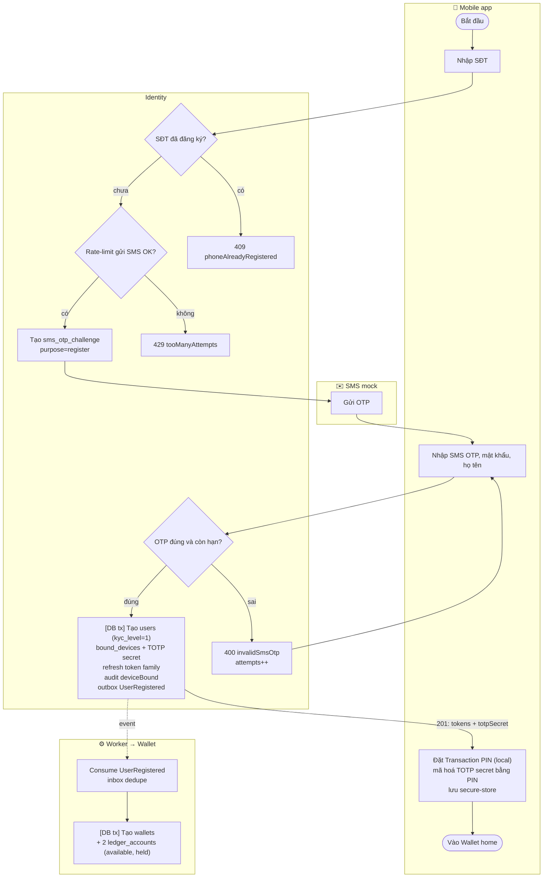

Wallet được tạo bất đồng bộ. Nếu `GET /wallet` được gọi trước khi Worker xử lý xong thì trả `202 walletProvisioning`, app retry sau khoảng 1 giây.

## 2. Đăng nhập + kích hoạt thiết bị (UC-02, UC-03)

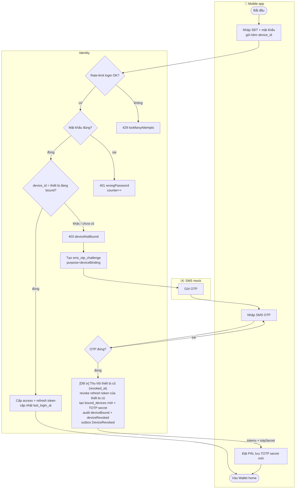

Thiết bị cũ ở request kế tiếp sẽ nhận `401 deviceRevoked`. App xoá secure-store và đưa User về màn kích hoạt lại (`apps/mobile/CLAUDE.md`).

## 3. Liên kết / huỷ liên kết ngân hàng (UC-20, UC-21)

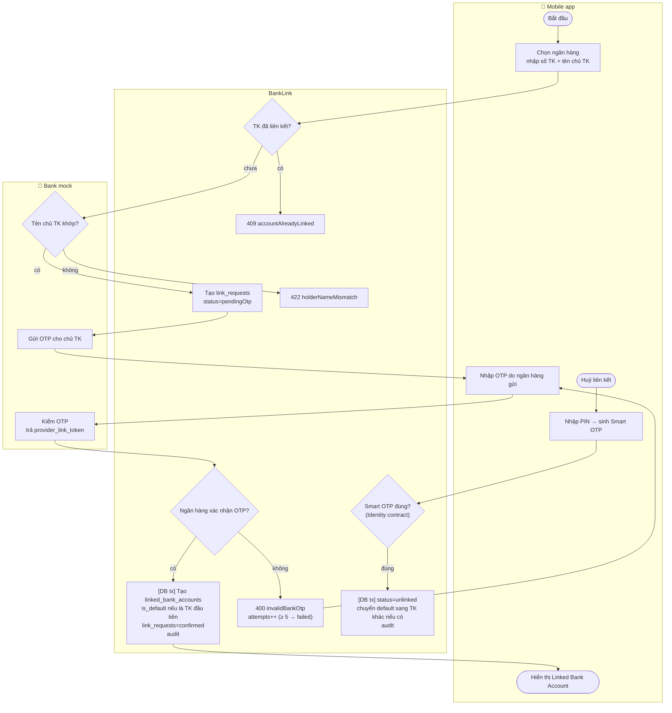

Huỷ liên kết không ảnh hưởng tới Transaction đang `Processing` dùng tài khoản đó. Lệnh gửi ngân hàng vẫn chạy đến khi có kết quả.

## 4. P2P Transfer (UC-31)

Đồng bộ: mọi thứ xong trong một request.

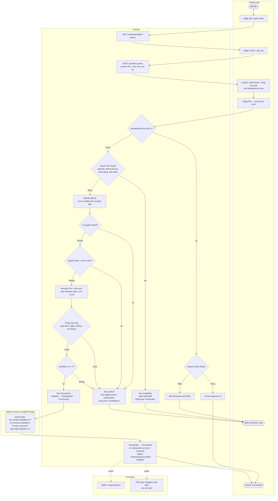

- Hai request cùng Idempotency-Key đến **song song**: request sau bị chặn bởi unique `(user_id, key)` (insert key ngay sau `BEGIN`), chờ request trước commit rồi trả response cũ.
- Nếu phí tính lại lệch so với quote, trả `409 feeChanged` để FE hiển thị lại màn Confirm (dùng key mới).

## 5. Bank Transfer (UC-32)

Bất đồng bộ: HTTP trả `202 Processing`, kết quả cuối đến qua callback.

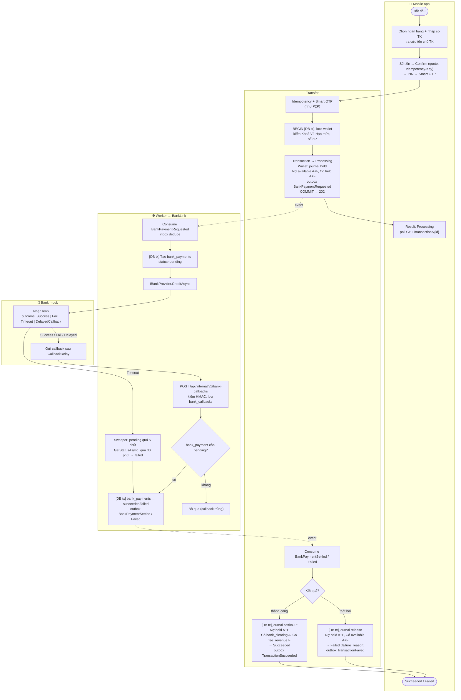

- Ngân hàng nhận lệnh nhưng lỗi kỹ thuật lúc gọi (`B3` throw): consumer retry theo chính sách messaging. Retry an toàn vì `provider_ref` được gắn idempotent theo `transaction_id`.
- Callback trùng, hoặc callback đến sau khi sweeper đã chốt kết quả: bị bỏ qua ở `B5` và vẫn được lưu lại để đối soát.

## 6. Top-up (UC-33)

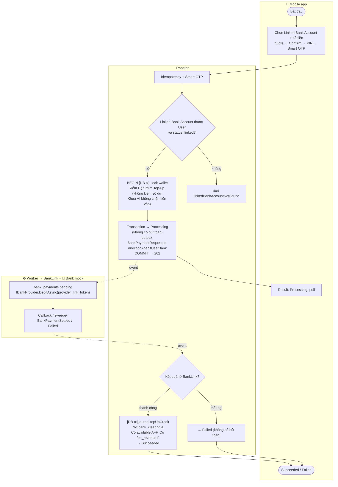

## 7. Withdrawal (UC-34)

Giống Bank Transfer (§5). Chỉ khác ở các điểm sau:

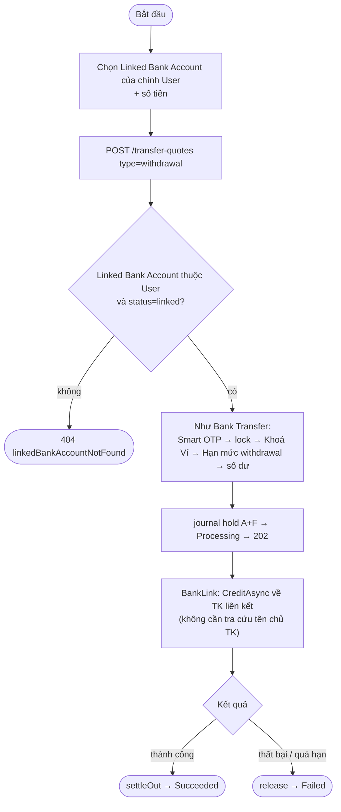

## 8. Config Version: maker–checker (UC-60..UC-63, UC-83)

Áp dụng cho cả Phí và Hạn mức.

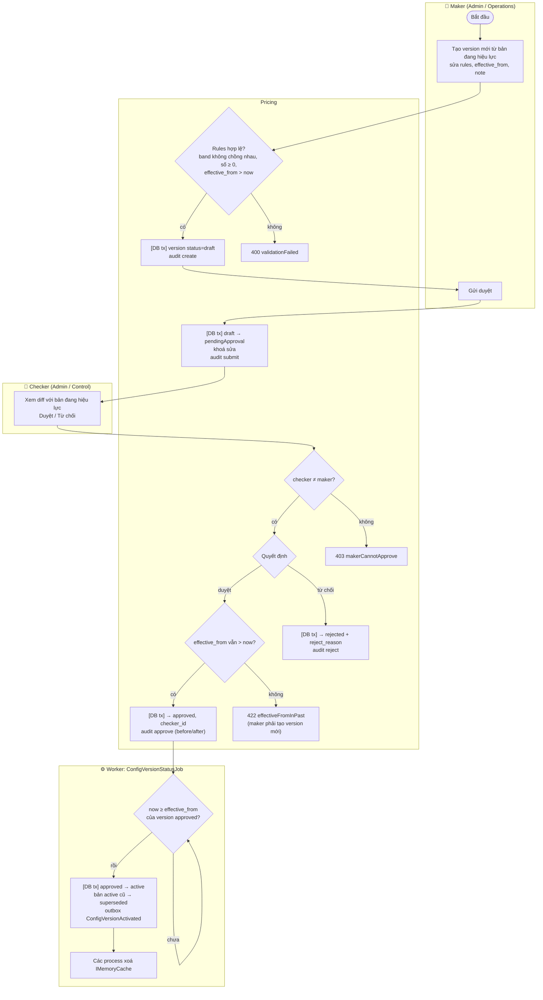

Phí và Hạn mức có hiệu lực **theo `effective_from`** ngay khi version ở trạng thái `approved` (D12). Job chỉ đồng bộ status để hiển thị và xoá cache. Nếu job chạy trễ thì lệnh chuyển tiền vẫn resolve đúng version.

## 9. Reversal (UC-54)

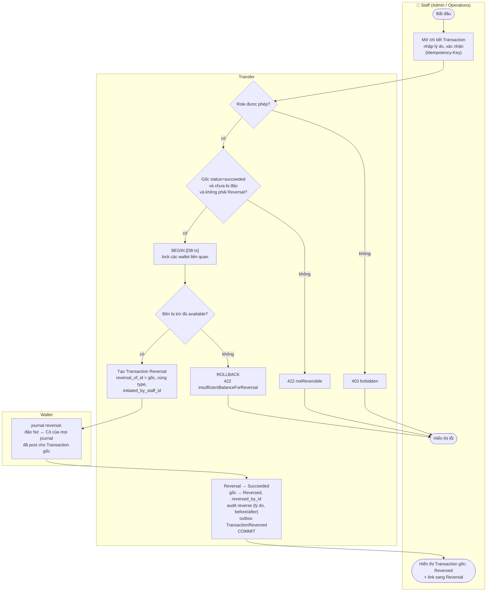

- Với Bank Transfer hoặc Withdrawal đã `Succeeded`, Reversal chỉ ghi ngược trên Sổ cái (`bank_clearing` → `wallet:available`). Việc đòi tiền thật từ ngân hàng nằm ngoài hệ thống và ngoài MVP.
- Reversal không cần Smart OTP, vì người thao tác là Staff. Thay vào đó cần role, lý do bắt buộc và audit.

## 10. Khoá / mở khoá Ví (UC-56)

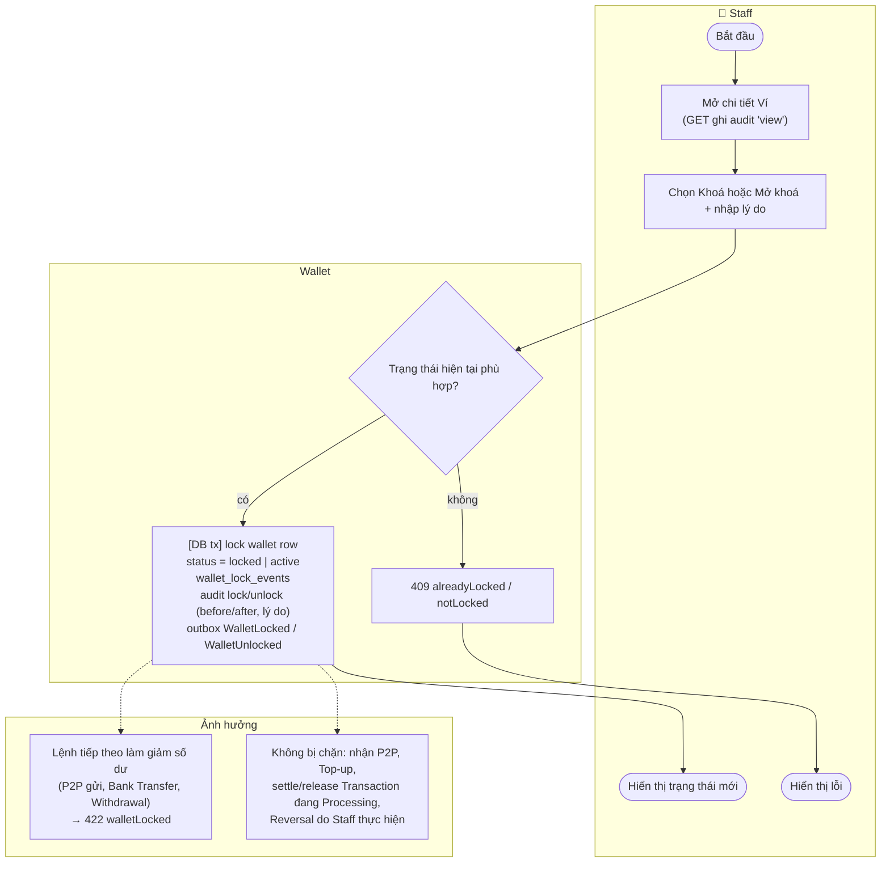

## 11. Refresh token rotation (UC-04)

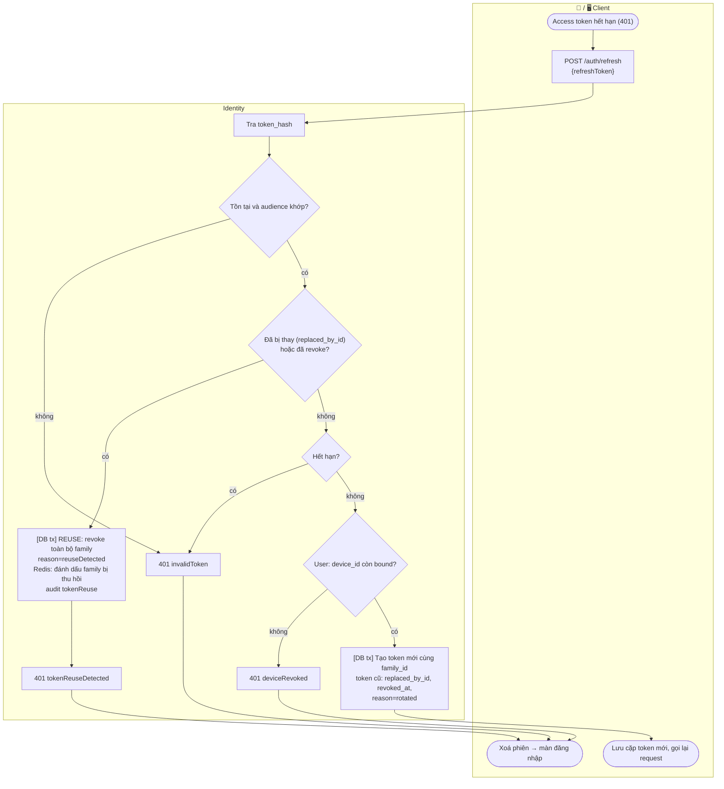

Hai request refresh song song với cùng một token (thường gặp khi app mở nhiều tab hoặc retry): cho phép một khoảng ân hạn 10 giây. Trong khoảng này, request thứ hai nhận lại đúng cặp token vừa cấp thay vì bị coi là reuse.
