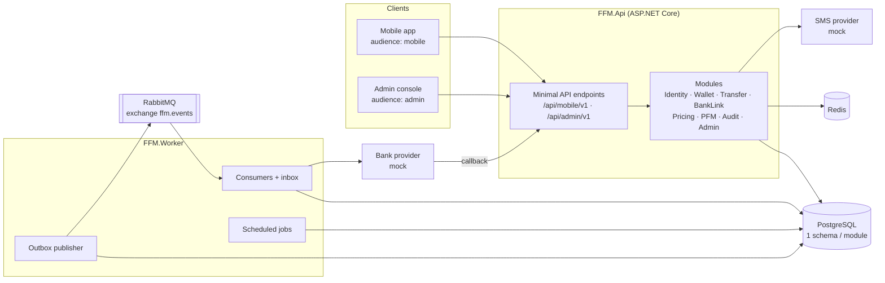
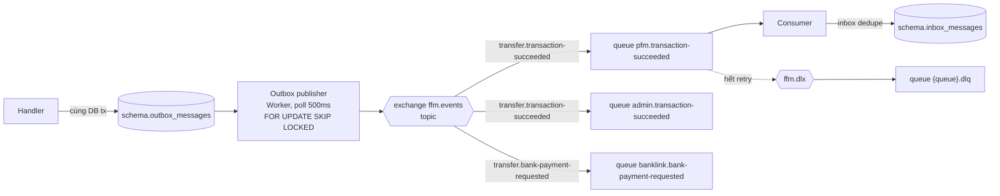

# Kiến trúc Backend

Modular monolith trên ASP.NET Core (.NET 10 LTS, pin bằng `global.json`, package quản lý tập trung qua `Directory.Packages.props`), PostgreSQL, RabbitMQ, Redis. Gồm hai process: `FFM.Api` (HTTP) và `FFM.Worker` (outbox publisher, consumer, job định kỳ). Cả hai nạp cùng các module. Xem ADR-0001, ADR-0002, ADR-0003.

## 1. Tổng quan



## 2. Module

| Module | Schema | Trách nhiệm | Phụ thuộc (qua Contracts) |
|---|---|---|---|
| Identity | `identity` | User, Staff, đăng ký, đăng nhập, JWT và refresh token, Bound Device, Smart OTP (TOTP), SMS OTP | Audit |
| Wallet | `wallet` | Wallet, Sổ cái (tài khoản, journal, bút toán), số dư snapshot, Khoá Ví | Audit |
| Transfer | `transfer` | `Transaction` và lifecycle cho Top-up, Withdrawal, P2P Transfer, Bank Transfer, Reversal; idempotency; kiểm hạn mức đã dùng | Wallet, Pricing, Identity, BankLink, Audit |
| BankLink | `banklink` | Danh mục ngân hàng, Linked Bank Account, adapter `IBankProvider`, theo dõi các lệnh gửi ngân hàng và callback | Identity, Audit |
| Pricing | `pricing` | Config Version của Phí và Hạn mức, maker–checker, resolve theo ngày hiệu lực | Audit |
| PFM | `pfm` | Category, Manual Entry, gán Category cho Transaction, Budget, Goal, endpoint `/activities` | Transfer |
| Audit | `audit` | Ghi và truy vấn Audit Log (append-only) | — |
| Admin | `admin` | Bảng thống kê cho Dashboard, ghép dữ liệu đọc cho console | Transfer, Wallet, Identity, BankLink, Pricing, Audit |

Quy tắc:

- Module chỉ đọc/ghi schema của chính nó. Gọi sang module khác thì dùng interface trong `Contracts`, hoặc consume integration event.
- Không JOIN xuyên schema. Thiếu dữ liệu thì gọi contract, hoặc giữ một projection riêng cập nhật từ event (PFM, Admin).
- Module Admin không có domain riêng. Nó chỉ đọc qua contract hoặc từ bảng thống kê của chính nó (D11).

## 3. Cấu trúc solution

```
backend/
├── FFM.sln
├── global.json                          # pin SDK .NET 10, bật Microsoft.Testing.Platform cho `dotnet test`
├── Directory.Build.props                # net10.0, nullable, implicit usings
├── Directory.Packages.props             # version mọi package (central package management)
├── compose.yaml                         # infra mặc định; profile `app` thêm api + worker
├── src/
│   ├── FFM.Api/                         # Host HTTP: Program.cs, auth, OpenAPI, exception handler
│   ├── FFM.Worker/                      # Host nền: outbox publisher, consumers, jobs
│   ├── FFM.BuildingBlocks/              # Result, handler abstractions, UnitOfWork, outbox/inbox,
│   │                                    # RabbitMQ client, ProblemDetails mapping, Clock, Id
│   └── Modules/
│       ├── Transfer/
│       │   ├── FFM.Modules.Transfer/            # internal
│       │   │   ├── Domain/                      # Transaction aggregate, TransactionStatus, rules (không EF)
│       │   │   ├── Application/                 # Commands/, Queries/, Validators/, DTOs
│       │   │   ├── Infrastructure/              # TransferDbContext, EF configs, Dapper queries,
│       │   │   │                                # migrations, consumers, adapters
│       │   │   ├── Api/                         # TransferEndpoints.cs (MapGroup)
│       │   │   └── TransferModule.cs            # AddTransferModule(), MapTransferEndpoints()
│       │   └── FFM.Modules.Transfer.Contracts/  # public: ITransactionQuery, events, DTO dùng chung
│       ├── Identity/ …
│       ├── Wallet/ …
│       ├── BankLink/ …
│       ├── Pricing/ …
│       ├── Pfm/ …
│       ├── Audit/ …
│       └── Admin/ …
└── tests/
    ├── FFM.ArchitectureTests/           # NetArchTest: quy tắc tầng và ranh giới module
    ├── FFM.BuildingBlocks.Tests/        # Result → ProblemDetails, pipeline lỗi, validation filter (TestServer)
    ├── FFM.Api.IntegrationTests/        # Api thật trên Testcontainers PostgreSQL, RabbitMQ, Redis
    ├── FFM.Modules.Transfer.Tests/      # unit (Domain, Application) + integration (Testcontainers)
    └── …
```

Quy tắc tham chiếu project:

- `FFM.Modules.X` được tham chiếu `FFM.BuildingBlocks` và `FFM.Modules.Y.Contracts`. **Không được** tham chiếu `FFM.Modules.Y`.
- `*.Contracts` chỉ được tham chiếu `FFM.BuildingBlocks`. Không chứa EF hay logic.
- `FFM.Api` và `FFM.Worker` tham chiếu mọi module và chỉ gọi `AddXxxModule()` / `MapXxxEndpoints()`.
- Kiểm bằng NetArchTest: `Domain` không phụ thuộc `Microsoft.EntityFrameworkCore`, `Application`, `Infrastructure`. Không type nào của module này trỏ vào phần internal của module khác.
- `*.Contracts` không tham chiếu assembly `FFM.*` nào ngoài `FFM.BuildingBlocks`, không tham chiếu EF Core.
- Project `FFM.Modules.X` chỉ public đúng class `XModule`, và class đó chỉ có `AddXModule` / `MapXEndpoints`. Host không dùng type nào khác của project module.

## 4. Đăng ký module (DI)

Mỗi module có một extension method duy nhất. Host không biết các class bên trong.

```csharp
public static class TransferModule
{
    public static IServiceCollection AddTransferModule(this IServiceCollection services, IConfiguration config)
    {
        services.AddDbContext<TransferDbContext>((sp, o) =>
            o.UseNpgsql(sp.GetRequiredService<IUnitOfWork>().Connection,
                npg => npg.MigrationsHistoryTable("__ef_migrations", "transfer")));

        // Handlers: Scoped, mỗi use case một class
        services.AddScoped<ICommandHandler<SubmitP2PTransfer, TransactionDto>, SubmitP2PTransferHandler>();
        services.AddScoped<ICommandHandler<SubmitBankTransfer, TransactionDto>, SubmitBankTransferHandler>();
        services.AddScoped<IQueryHandler<GetTransaction, TransactionDto>, GetTransactionHandler>();

        // Contract công khai cho module khác
        services.AddScoped<ITransactionQuery, TransactionQuery>();

        // Consumers (chỉ chạy trong Worker)
        services.AddConsumer<BankPaymentSettledConsumer, BankPaymentSettled>("transfer.bank-payment-settled");

        services.AddValidatorsFromAssembly(typeof(TransferModule).Assembly, includeInternalTypes: true);
        services.Configure<TransferOptions>(config.GetSection(TransferOptions.SectionName));
        return services;
    }

    public static IEndpointRouteBuilder MapTransferEndpoints(this IEndpointRouteBuilder app) { /* xem §6 */ }
}
```

Lifetime:

| Loại | Lifetime | Lý do |
|---|---|---|
| DbContext, handler, contract implementation, `IUnitOfWork` | Scoped | Gắn với một request hoặc một message |
| `IConnectionMultiplexer` (Redis), RabbitMQ connection, `IClock`, `TimeProvider` | Singleton | Tốn kém khi tạo, thread-safe |
| Validator (FluentValidation) | Scoped (mặc định của `AddValidatorsFromAssembly`) | — |
| Cache Config Version đang hiệu lực | Singleton (bọc `IMemoryCache`) | Xoá khi có event `ConfigVersionActivated` |

## 5. Tầng Application: handler cho mỗi use case

```csharp
// FFM.BuildingBlocks
public interface ICommandHandler<in TCommand, TResult>
{
    Task<Result<TResult>> HandleAsync(TCommand command, CancellationToken ct);
}
public interface IQueryHandler<in TQuery, TResult>
{
    Task<Result<TResult>> HandleAsync(TQuery query, CancellationToken ct);
}
```

- Endpoint inject đúng handler nó cần. Không dùng mediator (D3), nên F12 từ endpoint nhảy thẳng tới handler.
- Validation request nằm ở API boundary: một endpoint filter chạy `IValidator<TRequest>` và trả `400 validationFailed`.
- Transaction DB, outbox và audit được gọi tường minh trong handler, không ẩn trong pipeline.

Ví dụ khung của handler chuyển tiền P2P:

```csharp
internal sealed class SubmitP2PTransferHandler(
    IUnitOfWork uow, TransferDbContext db, IIdempotencyStore idempotency,
    ISmartOtpVerifier otp, IPricingQuery pricing, ILedgerPosting ledger,
    IAuditWriter audit, IOutbox outbox, TimeProvider clock)
    : ICommandHandler<SubmitP2PTransfer, TransactionDto>
{
    public async Task<Result<TransactionDto>> HandleAsync(SubmitP2PTransfer cmd, CancellationToken ct)
    {
        var replay = await idempotency.FindAsync(cmd.UserId, cmd.IdempotencyKey, cmd.RequestHash, ct);
        if (replay is not null) return replay;                     // gửi lại → trả response cũ, hoặc lỗi 409

        var otpCheck = await otp.VerifyAsync(cmd.UserId, cmd.DeviceId, cmd.SmartOtp, ct);
        if (otpCheck.IsFailure) return otpCheck.Error;             // không tạo Transaction (D8)

        await using var tx = await uow.BeginAsync(ct);             // một DB transaction cho mọi schema
        // 1. Lock Wallet người gửi và người nhận theo thứ tự id tăng dần (tránh deadlock)
        // 2. Resolve Phí + Hạn mức theo effective date và KYC Level, kiểm hạn mức đã dùng
        // 3. Tạo Transaction: Initiated → PendingAuth → Processing
        // 4. ledger.PostAsync(journal P2P) → cập nhật snapshot số dư
        // 5. Transaction → Succeeded; ghi idempotency key + response
        // 6. outbox.Add(TransactionSucceeded); audit nếu cần
        await tx.CommitAsync(ct);
        return dto;
    }
}
```

### Một DB transaction xuyên schema

Mọi schema nằm trong cùng một database PostgreSQL. `IUnitOfWork` (Scoped, trong BuildingBlocks) mở **một** `NpgsqlConnection` và **một** `NpgsqlTransaction` cho mỗi scope. DbContext của tất cả module dùng chung connection đó (`UseNpgsql(connection)` + `Database.UseTransaction`).

Nhờ vậy, Transfer, Wallet, Audit và outbox commit cùng nhau, mà vẫn không module nào đọc bảng của module khác. Cách này chỉ đúng khi còn là monolith. Nếu sau này tách module ra service riêng, luồng tương ứng phải chuyển sang saga dựa trên event (ADR-0002 đã dự liệu).

## 6. Endpoint (Minimal API)

```csharp
public static IEndpointRouteBuilder MapTransferEndpoints(this IEndpointRouteBuilder app)
{
    var mobile = app.MapGroup("/api/mobile/v1")
        .RequireAuthorization(Policies.MobileUser)               // audience = mobile
        .WithTags("Transfer");

    mobile.MapPost("/p2p-transfers", async (
            P2PTransferRequest body,
            [FromHeader(Name = "Idempotency-Key")] Guid idempotencyKey,
            [FromHeader(Name = "X-Smart-Otp")] string smartOtp,
            ICommandHandler<SubmitP2PTransfer, TransactionDto> handler,
            ICurrentUser user, CancellationToken ct) =>
        (await handler.HandleAsync(body.ToCommand(user, idempotencyKey, smartOtp), ct))
            .ToHttpResult(created: dto => $"/api/mobile/v1/transactions/{dto.Id}"))
        .AddEndpointFilter<ValidationFilter<P2PTransferRequest>>()
        .RequireRateLimiting("money-command");

    var admin = app.MapGroup("/api/admin/v1")
        .RequireAuthorization(Policies.Staff)                    // audience = admin
        .WithTags("Transfer");

    admin.MapPost("/transactions/{id:guid}/reversals", /* … */)
        .RequireAuthorization(Policies.Roles(StaffRole.Admin, StaffRole.Operations));

    return app;
}
```

- Group theo audience lấy từ BuildingBlocks: `MapMobileApi()` (`/api/mobile/v1`, policy `MobileUser`), `MapAdminApi()` (`/api/admin/v1`, policy `Staff`), `MapInternalApi()` (`/api/internal/v1`, không JWT, ký HMAC). Module gọi các hàm này thay vì tự viết prefix.
- Hai policy `MobileUser` và `Staff` kiểm claim `aud`. Thiếu hoặc sai token trả `401 invalidToken`; token hợp lệ nhưng sai audience (User gọi endpoint admin và ngược lại) trả `403 forbidden`, khớp [api.md §3](api.md#3-mã-lỗi).
- DTO là `record`. Không bao giờ trả entity EF ra API.
- OpenAPI sinh bằng `Microsoft.AspNetCore.OpenApi` và là nguồn để generate `packages/api-client`.

## 7. Result và xử lý lỗi

```csharp
public sealed record Error(string Code, ErrorKind Kind, string? Detail = null);
public enum ErrorKind { Validation, NotFound, Conflict, Forbidden, Unauthorized, BusinessRule }

public readonly struct Result<T>
{
    public bool IsSuccess { get; }
    public T? Value { get; }
    public Error? Error { get; }
    public static implicit operator Result<T>(T value) => /* success */;
    public static implicit operator Result<T>(Error error) => /* failure */;
}
```

- `Error.Code` chính là message key mà FE hiển thị, ví dụ `overBalance`, `overLimit`, `walletLocked`. Danh sách đầy đủ ở [api.md §3](api.md#3-mã-lỗi).
- Extension `ToHttpResult()` map `ErrorKind` sang status code (400 / 404 / 409 / 403 / 401 / 422) và trả `ProblemDetails` có thêm `code` và `traceId`.
- Exception bất ngờ do `IExceptionHandler` toàn cục bắt: log kèm `traceId`, trả 500 `internalError`, không lộ stack trace. Log **không bao giờ** chứa số tiền gắn với danh tính, token hay OTP.
- Chỉ có một chỗ dựng problem: `ErrorProblem` (BuildingBlocks). `ToHttpResult()`, `ValidationFilter<T>` (`400 validationFailed` kèm `errors` theo field camelCase), exception handler và challenge/forbid của JWT đều đi qua nó. `type` có dạng `https://ffm.dev/errors/<code-kebab>`.
- Log: Serilog, JSON compact ra stdout (`AddStructuredLogging()`), cấu hình mức log ở section `Serilog`.

## 8. Truy cập dữ liệu

| Việc | Công cụ |
|---|---|
| Ghi, load aggregate | EF Core. Mỗi module một DbContext, `HasDefaultSchema("<module>")`, migration riêng |
| Danh sách, lọc, báo cáo (admin), statement | Dapper với SQL tường minh, chỉ trong schema của module đó |
| Đọc không theo dõi thay đổi | `AsNoTracking()` |
| Tiền | Cột `bigint`, kiểu `long` trong C#. Không bao giờ dùng `decimal` hay `double` cho số tiền |
| Thời gian | `timestamptz`, lưu UTC. Ngày tính hạn mức và Budget theo múi giờ `Asia/Ho_Chi_Minh` |
| Khoá chính | `uuid` (UUIDv7 sinh ở app để index có thứ tự). Mã tham chiếu đọc được cho người dùng (`reference`) để riêng |

Post bút toán lên Sổ cái:

1. `SELECT … FROM wallet.wallets WHERE id = ANY(@ids) ORDER BY id FOR UPDATE`. Lock theo thứ tự cố định để tránh deadlock.
2. Kiểm số dư khả dụng và Khoá Ví.
3. Insert `journal_entries` và `ledger_entries` (tổng nợ = tổng có, kiểm cả ở Domain lẫn bằng constraint trigger).
4. Update snapshot `available_balance` / `held_balance`.
5. Ghi outbox. Commit.

## 9. Messaging (ADR-0003)



- Exchange `ffm.events` kiểu topic. Routing key có dạng `<module>.<event-kebab>`.
- Mỗi consumer có queue riêng `<consumer-module>.<event-kebab>`, durable, publisher confirm bật, consumer ack thủ công.
- Retry 3 lần với backoff (5s, 30s, 2 phút) qua delay queue có TTL. Hết lượt thì message vào `<queue>.dlq` qua exchange `ffm.dlx`.
- Inbox key là (`message_id`, `consumer`). Ghi inbox và tác động nghiệp vụ nằm trong cùng DB transaction.
- Message envelope: `{ messageId, type, occurredAt, correlationId, causationId, payload }`. `correlationId` lấy từ `Transaction.Id` để trace xuyên suốt.

Danh sách event: xem [api.md §5](api.md#5-service-contract-và-event-theo-module).

## 10. Provider ngoài (mock)

```csharp
public sealed class BankProviderOptions
{
    public const string SectionName = "BankProvider";
    public string Mode { get; init; } = "mock";                       // key của keyed service
    public MockOutcome DefaultOutcome { get; init; } = MockOutcome.Success;
    public TimeSpan CallbackDelay { get; init; } = TimeSpan.FromSeconds(4);
    public Dictionary<string, MockOutcome> OutcomeByAccountSuffix { get; init; } = new();  // vd "0000" → Fail
}
public enum MockOutcome { Success, Fail, Timeout, DelayedCallback }

services.AddKeyedScoped<IBankProvider, MockBankProvider>("mock");
services.AddScoped<IBankProvider>(sp => sp.GetRequiredKeyedService<IBankProvider>(
    sp.GetRequiredService<IOptions<BankProviderOptions>>().Value.Mode));
```

- `MockBankProvider` không trả kết quả ngay. Nó lên lịch gọi callback về `POST /api/internal/v1/bank-callbacks` sau `CallbackDelay`. Callback được ký HMAC giống provider thật.
- Với `Timeout`, mock không bao giờ gọi callback. Job `BankPaymentTimeoutSweeper` sẽ hỏi lại trạng thái (`IBankProvider.GetStatusAsync`) rồi chốt kết quả.
- Để test outcome theo từng request, mock chọn kết quả theo đuôi số tài khoản (`OutcomeByAccountSuffix`).
- `ISmsSender` làm tương tự (`MockSmsSender` ghi log và lưu mã gần nhất để môi trường dev đọc được).

## 11. Cache và Redis (D13)

| Dữ liệu | Nơi lưu | Ghi chú |
|---|---|---|
| Rate-limit login, SMS OTP, Smart OTP | Redis (`INCR` + `EXPIRE`) | Key `rl:{scope}:{subject}`. Sai Smart OTP 5 lần thì khoá 15 phút |
| Chống dùng lại Smart OTP | Redis `SET NX` `otp:used:{userId}:{timeStep}` TTL 90s | Một mã TOTP chỉ dùng được một lần |
| Refresh token family bị thu hồi | Redis (đọc nhanh) + Postgres (nguồn gốc) | — |
| Config Version Phí/Hạn mức đang hiệu lực | `IMemoryCache`, mỗi process một bản | Xoá khi consume `ConfigVersionActivated`, TTL an toàn 5 phút |
| Số dư, hạn mức đã dùng | **Không cache** | Luôn đọc từ DB trong transaction đang lock Wallet |

## 12. Bảo mật

- **JWT**: access token sống 10 phút. Claim gồm `sub`, `aud` (`mobile` / `admin`), `role` (Staff), `device_id` (User). Ký bằng khoá bất đối xứng (RS256 hoặc ES256).
- **Refresh token**: chuỗi ngẫu nhiên, DB chỉ lưu SHA-256 của nó. Mỗi lần refresh cấp token mới và đánh dấu token cũ `replaced_by`. Nếu một token đã bị thay mà lại được dùng, toàn bộ family bị thu hồi và ghi Audit.
- **Bound Device**: mỗi User chỉ có một thiết bị đang active. Kích hoạt thiết bị mới thì thiết bị cũ bị thu hồi, refresh token của thiết bị cũ bị revoke, và phát event `DeviceRevoked`. Request mang `device_id` đã bị thu hồi nhận `401 deviceRevoked`.
- **Smart OTP**: TOTP (RFC 6238, 30 giây, 6 số, cho lệch ±1 bước). Secret mã hoá lúc lưu bằng ASP.NET Data Protection. Chỉ kiểm với thiết bị đang bound.
- **Transaction PIN** (D14): chỉ nằm trên thiết bị, dùng để mở khoá secret Smart OTP. Server không lưu và không nhận PIN. Rủi ro máy root được chấp nhận ở mức demo; hướng giảm thiểu sau này là Play Integrity / App Attest.
- **Staff**: đăng nhập bằng mật khẩu (ASP.NET Identity hasher) kèm TOTP 2FA bắt buộc. Phân quyền theo role ở mọi endpoint. Ma trận quyền ở [use-cases.md](use-cases.md#4-ma-trận-quyền-staff).
- **Audit**: thao tác của Staff (kể cả *xem* dữ liệu cá nhân) và sự kiện bảo mật của User đi qua `IAuditWriter`, trong cùng DB transaction với use case.
- **Dữ liệu nhạy cảm**: số tài khoản ngân hàng mã hoá lúc lưu, chỉ trả bản mask. Log dùng structured logging, có bộ lọc che `phone`, `accountNumber`, `token`, `otp`.

## 13. Job trong Worker

| Job | Chu kỳ | Việc |
|---|---|---|
| `OutboxPublisher` | 500 ms | Publish outbox của từng schema, đánh dấu `published_at` |
| `BankPaymentTimeoutSweeper` | 1 phút | Lệnh gửi ngân hàng ở `Pending` quá 5 phút: hỏi lại trạng thái, quá 30 phút thì đánh `Failed` |
| `ConfigVersionStatusJob` | 1 phút | Đổi `Approved → Active` và bản cũ `→ Superseded` khi tới `effective_from`, phát `ConfigVersionActivated` (D12) |
| `IdempotencyKeyCleanup` | hằng ngày | Xoá key quá 30 ngày |
| `OutboxInboxCleanup` | hằng ngày | Xoá outbox đã publish và inbox quá 14 ngày |
| `LedgerIntegrityCheck` | hằng ngày | Kiểm từng journal cân bằng và snapshot số dư khớp tổng bút toán. Lệch thì cảnh báo, không tự sửa |

## 14. Cấu hình (IOptions)

```json
{
  "ConnectionStrings": { "Postgres": "…", "Redis": "…", "RabbitMq": "amqp://…" },
  "Jwt": { "Issuer": "ffm", "AccessTokenLifetime": "00:10:00", "RefreshTokenLifetime": "30.00:00:00" },
  "SmartOtp": { "StepSeconds": 30, "AllowedDriftSteps": 1, "MaxFailedAttempts": 5, "LockoutDuration": "00:15:00" },
  "SmsOtp": { "Length": 6, "Lifetime": "00:05:00", "MaxSendPerHour": 5 },
  "BankProvider": { "Mode": "mock", "DefaultOutcome": "Success", "CallbackDelay": "00:00:04" },
  "Sms": { "Mode": "mock" },
  "Transfer": { "QuoteLifetime": "00:05:00", "BankPaymentTimeout": "00:30:00" },
  "Messaging": { "Exchange": "ffm.events", "DeadLetterExchange": "ffm.dlx", "MaxRetries": 3 }
}
```

Mỗi section có một class `XxxOptions` với `const SectionName`, đăng ký bằng `services.AddValidatedOptions<T>(SectionName)` (BuildingBlocks: `BindConfiguration` + `ValidateDataAnnotations` + `ValidateOnStart`). Secret (khoá ký JWT, HMAC callback, key Data Protection) lấy từ biến môi trường hoặc AWS SSM, không nằm trong `appsettings`.

- `Jwt:SigningKey`: khoá RSA private dạng PEM, truyền qua biến môi trường `Jwt__SigningKey`. Thiếu thì Api dừng ngay lúc khởi động.
- `appsettings.Development.json` chỉ chứa connection string trỏ vào Compose local (mật khẩu dev mặc định `ffm_dev`, không phải secret).

### Chạy local

```bash
cd backend
docker compose up -d                      # postgres (host port 5433), rabbitmq (5672, UI 15672), redis (6379)
export Jwt__SigningKey="$(openssl genrsa 2048)"
dotnet watch --project src/FFM.Api        # http://localhost:5080
dotnet watch --project src/FFM.Worker
```

Postgres của Compose map ra cổng 5433 để không đụng PostgreSQL cài sẵn trên máy (đổi bằng `POSTGRES_PORT`). Profile `app` (`docker compose --profile app up -d`) đã khai báo `api` và `worker`; image của chúng có ở plan Delivery.

### Health

`/health/live` chỉ xác nhận process còn trả lời. `/health/ready` kiểm PostgreSQL (`SELECT 1`), RabbitMQ (mở connection) và Redis (`PING`), mỗi check timeout 3 giây; một dependency hỏng thì trả `503` với `{ status, entries: { postgres, rabbitmq, redis } }`. Health check tự viết trong BuildingBlocks, không thêm package.

## 15. Testing

| Loại | Công cụ | Phạm vi |
|---|---|---|
| Unit | xUnit + NSubstitute | Domain (lifecycle Transaction, tính Phí, Hạn mức, journal cân bằng), handler với các contract được mock |
| Integration | xUnit + Testcontainers (PostgreSQL, RabbitMQ) + `WebApplicationFactory` | Endpoint đến DB thật, outbox đến consumer |
| Architecture | NetArchTest | Quy tắc tầng, ranh giới module, `internal` |

Theo `backend/CLAUDE.md`, mọi thay đổi ở Ledger, Transfer hoặc Pricing phải kèm test cho các trường hợp sau:

- Gửi lại cùng idempotency key thì trả response cũ. Cùng key mà payload khác thì `409`.
- N request trừ tiền song song trên cùng một Wallet: tổng không vượt số dư, không có deadlock.
- Biên hạn mức mỗi giao dịch / ngày / tháng / số lượng, theo từng KYC Level, ngay tại giá trị biên và biên ± 1.
- Phí và hạn mức resolve theo `effective_from`, ngay trước và sau thời điểm chuyển phiên bản.
- Bank-facing: Success, Fail, Timeout, callback đến trễ, callback đến hai lần.

Không dùng EF InMemory cho integration test: nó không mô phỏng được `FOR UPDATE`, transaction và constraint.

- `dotnet test` chạy bằng Microsoft.Testing.Platform (xunit.v3, bật trong `global.json`). Lọc test: `dotnet test --project <proj> -- --filter-class "*Name"`.
- `FFM.Api.IntegrationTests` dùng chung một bộ container cho cả assembly (assembly fixture). Test cần pause container nằm trong collection `PausesContainers`, chạy riêng, không song song với test khác.
- Mỗi rule NetArchTest có thêm một test chạy rule đó trên fixture cố tình vi phạm (`tests/FFM.ArchitectureTests/Fixtures`), để chứng minh rule thật sự bắt được lỗi.
