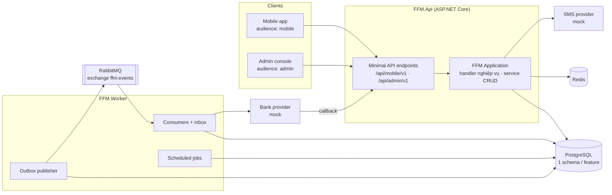
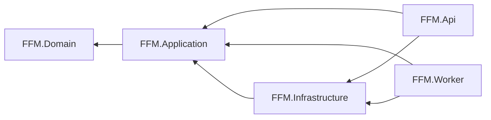
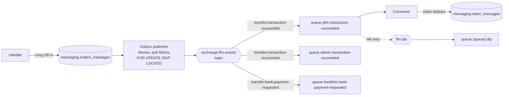

# Kiến trúc Backend

Clean Architecture trên ASP.NET Core (.NET 10 LTS, pin bằng `global.json`, package quản lý tập trung qua `Directory.Packages.props`), PostgreSQL, RabbitMQ, Redis. Code chia thành bốn project theo tầng: `FFM.Domain`, `FFM.Application`, `FFM.Infrastructure`, `FFM.Api`. Có thêm host nền `FFM.Worker` (outbox publisher, consumer, job định kỳ). Phụ thuộc chỉ hướng vào trong. Xem ADR-0001, ADR-0003, ADR-0004 (ADR-0004 thay ADR-0002).

## 1. Tổng quan



Tầng và hướng phụ thuộc:



| Project | Chứa | Được tham chiếu |
|---|---|---|
| `FFM.Domain` | Entity, value object, quy tắc nghiệp vụ, interface repository, `Result`/`Error` | Không gì cả, chỉ BCL |
| `FFM.Application` | Use case: handler nghiệp vụ, service CRUD, DTO, validator, interface ra ngoài (`IUnitOfWork`, `ILedgerPosting`, `IBankProvider` …) | `FFM.Domain`, FluentValidation |
| `FFM.Infrastructure` | Hiện thực interface của Domain/Application: EF Core, Dapper, Redis, RabbitMQ, provider mock, health check, logging, job, consumer | `FFM.Application` (và qua đó `FFM.Domain`) |
| `FFM.Api` | Endpoint, middleware, filter, auth, ánh xạ lỗi sang ProblemDetails, `Program.cs` | `FFM.Application`, `FFM.Infrastructure` (chỉ để đăng ký DI) |
| `FFM.Worker` | `Program.cs` của host nền | `FFM.Application`, `FFM.Infrastructure` |

## 2. Feature

Không còn module tách project. Mỗi vùng nghiệp vụ (feature) là một **thư mục con** lặp lại trong từng tầng, ví dụ `Domain/Entities/Transfer/`, `Application/UseCases/Transfer/`, `Infrastructure/Data/Configurations/Transfer/`, `Api/Endpoints/Transfer/`.

| Feature | Schema | Trách nhiệm |
|---|---|---|
| Identity | `identity` | User, Staff, đăng ký, đăng nhập, JWT và refresh token, Bound Device, Smart OTP (TOTP), SMS OTP |
| Wallet | `wallet` | Wallet, Sổ cái (tài khoản, journal, bút toán), số dư snapshot, Khoá Ví |
| Transfer | `transfer` | `Transaction` và lifecycle cho Top-up, Withdrawal, P2P Transfer, Bank Transfer, Reversal; idempotency; kiểm hạn mức đã dùng |
| BankLink | `banklink` | Danh mục ngân hàng, Linked Bank Account, adapter `IBankProvider`, theo dõi các lệnh gửi ngân hàng và callback |
| Pricing | `pricing` | Config Version của Phí và Hạn mức, maker–checker, resolve theo ngày hiệu lực |
| PFM | `pfm` | Category, Manual Entry, gán Category cho Transaction, Budget, Goal, endpoint `/activities` |
| Audit | `audit` | Ghi và truy vấn Audit Log (append-only) |
| Admin | `admin` | Bảng thống kê cho Dashboard |

Quy tắc sở hữu (là quy ước, kiểm bằng code review vì cùng nằm trong một project):

- **Transfer** sở hữu `Transaction` và lifecycle của mọi loại, kể cả Reversal. Chỉ handler trong `UseCases/Transfer/` đổi trạng thái Transaction.
- **Wallet** sở hữu Sổ cái. Bút toán chỉ được ghi qua `ILedgerPosting`; không handler nào insert `ledger_entries` trực tiếp.
- **PFM** sở hữu việc gán Category cho Transaction (`pfm.transaction_categories`).
- **Admin** chỉ giữ Dashboard (D11). Các màn admin khác (transactions, wallets, config, audit) là endpoint của feature sở hữu dữ liệu, gắn vào group `/api/admin/v1`.
- Ghi dữ liệu của một feature đi qua repository/aggregate của feature đó. Truy vấn đọc (Dapper) được JOIN xuyên schema khi cần, vì giờ mọi schema thuộc cùng một codebase và một DbContext.

## 3. Cấu trúc solution

```
backend/
├── FFM.sln
├── global.json                          # pin SDK .NET 10, bật Microsoft.Testing.Platform cho `dotnet test`
├── Directory.Build.props                # net10.0, nullable, implicit usings
├── Directory.Packages.props             # version mọi package (central package management)
├── compose.yaml                         # infra mặc định; profile `app` thêm api + worker
├── src/
│   ├── FFM.Domain/                      # Lõi nghiệp vụ, không phụ thuộc gì
│   │   ├── Common/                      # Result, Result<T>, Error, ErrorKind, ErrorCodes
│   │   ├── Entities/<Feature>/          # Wallet, Transaction, ConfigVersion … (aggregate, không EF)
│   │   ├── ValueObjects/                # Money (long VND), Period, LimitRule …
│   │   ├── Interfaces/                  # I<Aggregate>Repository
│   │   ├── Errors/                      # <Feature>Errors: mã lỗi nghiệp vụ (api.md §3)
│   │   └── Exceptions/                  # Chỉ cho vi phạm bất biến = bug (vd journal lệch)
│   ├── FFM.Application/                 # Use case
│   │   ├── Interfaces/                  # ICommandHandler, IQueryHandler, IUnitOfWork, IIdGenerator,
│   │   │                                # ILedgerPosting, IAuditWriter, IOutbox, IBankProvider, ISmsSender,
│   │   │                                # I<Feature>Query (đọc), I<Name>Service (CRUD)
│   │   ├── UseCases/<Feature>/          # Nghiệp vụ: Commands/ và Queries/, mỗi use case một handler
│   │   ├── Services/<Feature>/          # CRUD: <Name>Service
│   │   ├── DTOs/<Feature>/              # record trả ra API
│   │   ├── Validators/<Feature>/        # FluentValidation cho request
│   │   └── DependencyInjection.cs       # AddApplication()
│   ├── FFM.Infrastructure/              # Hiện thực bên ngoài
│   │   ├── Data/                        # FfmDbContext, Configurations/<Feature>/, Migrations/,
│   │   │                                # Repositories/, Queries/ (Dapper), UnitOfWork, LedgerPosting
│   │   ├── Caching/                     # Redis (rate limit, OTP replay, token family), cache Config Version
│   │   ├── Messaging/                   # Outbox, inbox, RabbitMQ publisher và consumer
│   │   ├── External/                    # Bank/, Sms/: adapter mock (keyed service)
│   │   ├── Jobs/                        # Job định kỳ của Worker
│   │   ├── Health/                      # Health check PostgreSQL, RabbitMQ, Redis
│   │   ├── Logging/                     # Serilog
│   │   ├── Common/                      # UuidV7Generator …
│   │   └── DependencyInjection/         # AddInfrastructure(), AddWorkerServices(), options kết nối
│   ├── FFM.Api/                         # Entry point HTTP
│   │   ├── Endpoints/                   # AudienceGroups, HealthEndpoints, <Feature>/<Feature>Endpoints.cs
│   │   ├── Middleware/                  # Exception handler toàn cục
│   │   ├── Filters/                     # ValidationFilter<T>, WithValidation<T>()
│   │   ├── Errors/                      # ErrorProblem, ToHttpResult()
│   │   ├── Auth/                        # JWT, policy theo audience
│   │   └── Program.cs
│   └── FFM.Worker/                      # Host nền: Program.cs
└── tests/
    ├── FFM.UnitTests/                   # Domain/, Application/ (NSubstitute), Api/ (pipeline lỗi, filter, TestServer)
    ├── FFM.ArchitectureTests/           # Hướng phụ thuộc giữa tầng, vị trí handler/service
    └── FFM.Api.IntegrationTests/        # Api thật trên Testcontainers PostgreSQL, RabbitMQ, Redis
```

Thư mục rỗng không được commit; mỗi thư mục trên xuất hiện khi có file đầu tiên.

Quy tắc tham chiếu (kiểm bằng `FFM.ArchitectureTests`):

- `FFM.Domain` chỉ tham chiếu BCL (`System.*`).
- `FFM.Application` không tham chiếu `FFM.Infrastructure`, `FFM.Api`, `FFM.Worker`, cũng không tham chiếu ASP.NET Core, EF Core, Npgsql, Dapper, RabbitMQ, Redis, Serilog.
- `FFM.Infrastructure` không tham chiếu `FFM.Api` hay `FFM.Worker`.
- `FFM.Worker` không tham chiếu `FFM.Api`.
- Class hiện thực `ICommandHandler`/`IQueryHandler` nằm dưới `FFM.Application.UseCases` và tên kết thúc bằng `Handler`. Class tên `*Service` trong Application nằm dưới `FFM.Application.Services`.
- Type trong `FFM.Api` là `internal` (trừ `Program` và options). `FFM.UnitTests` thấy chúng qua `InternalsVisibleTo`.

## 4. Đăng ký DI

Mỗi tầng có một extension method; host gọi chúng theo thứ tự trong `Program.cs`.

```csharp
// FFM.Api/Program.cs
builder.AddStructuredLogging();
builder.Services.AddApplication();          // handler, service CRUD, validator
builder.Services.AddInfrastructure();       // DbContext, repository, query, cache, provider, outbox writer
builder.Services.AddDependencyHealthChecks();
builder.Services.AddErrorHandling();
builder.Services.AddJwtAuthentication();
…
app.MapHealthEndpoints();
app.MapApiEndpoints();                      // gọi <Feature>Endpoints.Map của từng feature

// FFM.Worker/Program.cs
builder.AddStructuredLogging();
builder.Services.AddApplication();
builder.Services.AddInfrastructure();
builder.Services.AddWorkerServices();       // outbox publisher, consumer, job: chỉ Worker gọi
```

Consumer và job đăng ký trong `AddWorkerServices()`, nên Api không bao giờ chạy chúng.

```csharp
// FFM.Application/DependencyInjection.cs
public static IServiceCollection AddApplication(this IServiceCollection services)
{
    // Nghiệp vụ: mỗi use case một handler
    services.AddScoped<ICommandHandler<SubmitP2PTransfer, TransactionDto>, SubmitP2PTransferHandler>();
    services.AddScoped<IQueryHandler<GetTransaction, TransactionDto>, GetTransactionHandler>();

    // CRUD: một service cho một entity
    services.AddScoped<IManualEntryService, ManualEntryService>();

    services.AddValidatorsFromAssembly(typeof(DependencyInjection).Assembly, includeInternalTypes: true);
    return services;
}
```

Lifetime:

| Loại | Lifetime | Lý do |
|---|---|---|
| `FfmDbContext`, repository, handler, service CRUD, `IUnitOfWork` | Scoped | Gắn với một request hoặc một message |
| `NpgsqlDataSource`, `IConnectionMultiplexer` (Redis), RabbitMQ connection, `TimeProvider`, `IIdGenerator` | Singleton | Tốn kém khi tạo, thread-safe |
| Validator (FluentValidation) | Scoped (mặc định của `AddValidatorsFromAssembly`) | — |
| Cache Config Version đang hiệu lực | Singleton (bọc `IMemoryCache`) | Xoá khi có event `ConfigVersionActivated` |

## 5. Tầng Application: handler cho nghiệp vụ, service cho CRUD

```csharp
// FFM.Application/Interfaces
public interface ICommandHandler<in TCommand, TResult>
{
    Task<Result<TResult>> HandleAsync(TCommand command, CancellationToken ct);
}
public interface IQueryHandler<in TQuery, TResult>
{
    Task<Result<TResult>> HandleAsync(TQuery query, CancellationToken ct);
}
```

Use case nào thuộc loại nào:

| Dùng **handler** (`UseCases/<Feature>/Commands|Queries/`) khi use case có ít nhất một điều sau | Dùng **service** (`Services/<Feature>/`) khi |
|---|---|
| Đổi số dư, Transaction, Sổ cái, Khoá Ví | CRUD trên **một** entity thuộc chính User đang gọi |
| Cần idempotency key, Smart OTP, SMS OTP, maker–checker | Không có idempotency, OTP, audit, outbox |
| Phải ghi audit (mọi thao tác Staff, kể cả *xem*) hoặc ghi outbox | Không chạm aggregate của feature khác (đọc qua `I<Feature>Query` thì được) |
| Chạm nhiều aggregate hoặc nhiều feature trong một DB transaction | Không có lifecycle hay state machine |
| Có lifecycle / state machine (Transaction, Config Version, Bound Device) | |

Ví dụ: P2P Transfer, Reversal, khoá Ví, duyệt Config Version, kích hoạt thiết bị, liên kết ngân hàng, gán Category cho Transaction → **handler**. Manual Entry, Budget, Goal, danh sách Category, danh mục ngân hàng, danh sách Linked Bank Account → **service**. Trường hợp không rõ thì chọn handler; danh sách đầy đủ ở [api.md §5](api.md#5-use-case-interface-và-event-theo-feature).

- Endpoint inject đúng handler hoặc service nó cần. Không dùng mediator (D3), nên F12 từ endpoint nhảy thẳng tới code.
- Handler và service đều trả `Result<T>` / `Result`; endpoint map giống nhau (§7).
- Validation request nằm ở API boundary: `.WithValidation<TRequest>()` chạy `IValidator<TRequest>` và trả `400 validationFailed`.
- Transaction DB, outbox và audit được gọi tường minh trong handler, không ẩn trong pipeline.

Ví dụ khung của handler chuyển tiền P2P:

```csharp
internal sealed class SubmitP2PTransferHandler(
    IUnitOfWork uow, ITransactionRepository transactions, IIdempotencyStore idempotency,
    ISmartOtpVerifier otp, IPricingQuery pricing, ILedgerPosting ledger,
    IAuditWriter audit, IOutbox outbox, TimeProvider clock)
    : ICommandHandler<SubmitP2PTransfer, TransactionDto>
{
    public async Task<Result<TransactionDto>> HandleAsync(SubmitP2PTransfer cmd, CancellationToken ct)
    {
        var replay = await idempotency.FindAsync(cmd.UserId, cmd.IdempotencyKey, cmd.RequestHash, ct);
        if (replay is not null) return replay;                     // gửi lại → trả response cũ, hoặc lỗi 409

        var otpCheck = await otp.VerifyAsync(cmd.UserId, cmd.DeviceId, cmd.SmartOtp, ct);
        if (otpCheck.IsFailure) return otpCheck.Error;             // không tạo Transaction (D8)

        await using var tx = await uow.BeginAsync(ct);             // một DB transaction cho mọi schema
        // 1. Lock Wallet người gửi và người nhận theo thứ tự id tăng dần (tránh deadlock)
        // 2. Resolve Phí + Hạn mức theo effective date và KYC Level, kiểm hạn mức đã dùng
        // 3. Tạo Transaction: Initiated → PendingAuth → Processing
        // 4. ledger.PostAsync(journal P2P) → cập nhật snapshot số dư
        // 5. Transaction → Succeeded; ghi idempotency key + response
        // 6. outbox.Add(TransactionSucceeded); audit nếu cần
        await tx.CommitAsync(ct);
        return dto;
    }
}
```

Ví dụ service CRUD:

```csharp
// FFM.Application/Interfaces/IManualEntryService.cs
public interface IManualEntryService
{
    Task<Result<ManualEntryDto>> CreateAsync(Guid userId, ManualEntryRequest request, CancellationToken ct);
    Task<Result<ManualEntryDto>> UpdateAsync(Guid userId, Guid id, ManualEntryRequest request, CancellationToken ct);
    Task<Result> DeleteAsync(Guid userId, Guid id, CancellationToken ct);
}

// FFM.Application/Services/Pfm/ManualEntryService.cs
internal sealed class ManualEntryService(IManualEntryRepository entries, IIdGenerator ids, TimeProvider clock)
    : IManualEntryService
{
    public async Task<Result> DeleteAsync(Guid userId, Guid id, CancellationToken ct)
    {
        var entry = await entries.FindAsync(userId, id, ct);
        if (entry is null) return PfmErrors.ManualEntryNotFound;
        entries.Remove(entry);
        await entries.SaveChangesAsync(ct);
        return Result.Success();
    }
    // …
}
```

Service CRUD không mở `IUnitOfWork`, không ghi audit hay outbox. Khi một service cần một trong các thứ đó, use case ấy đã thành nghiệp vụ và phải chuyển sang handler.

### Một DB transaction xuyên schema

Mọi schema nằm trong cùng một database PostgreSQL và cùng **một** `FfmDbContext` (Infrastructure/Data). Mỗi entity map vào schema của feature bằng `ToTable("<table>", "<schema>")` trong `Configurations/<Feature>/`. `IUnitOfWork` (Scoped) bọc `FfmDbContext.Database.BeginTransactionAsync`; repository dùng chung DbContext đó, còn Dapper dùng chung connection và transaction qua `Database.GetDbConnection()` / `GetDbTransaction()`.

Nhờ vậy Transfer, Wallet, Audit và outbox commit cùng nhau mà không cần cơ chế enlist nhiều DbContext.

## 6. Endpoint (Minimal API)

Mỗi feature có một file `Api/Endpoints/<Feature>/<Feature>Endpoints.cs` với `internal static void Map(IEndpointRouteBuilder)`; `EndpointExtensions.MapApiEndpoints()` gọi lần lượt từng file.

```csharp
internal static class TransferEndpoints
{
    public static void Map(IEndpointRouteBuilder app)
    {
        var mobile = app.MapMobileApi().WithTags("Transfer");    // /api/mobile/v1, audience = mobile

        mobile.MapPost("/p2p-transfers", async (
                P2PTransferRequest body,
                [FromHeader(Name = "Idempotency-Key")] Guid idempotencyKey,
                [FromHeader(Name = "X-Smart-Otp")] string smartOtp,
                ICommandHandler<SubmitP2PTransfer, TransactionDto> handler,
                ICurrentUser user, CancellationToken ct) =>
            (await handler.HandleAsync(body.ToCommand(user, idempotencyKey, smartOtp), ct))
                .ToHttpResult(dto => TypedResults.Created($"/api/mobile/v1/transactions/{dto.Id}", dto)))
            .WithValidation<P2PTransferRequest>()
            .RequireRateLimiting("money-command");

        var admin = app.MapAdminApi().WithTags("Transfer");      // /api/admin/v1, audience = admin

        admin.MapPost("/transactions/{id:guid}/reversals", /* … */)
            .RequireAuthorization(Policies.Roles(StaffRole.Admin, StaffRole.Operations));
    }
}

// Endpoint CRUD gọi service
mobile.MapDelete("/manual-entries/{id:guid}", async (
        Guid id, IManualEntryService entries, ICurrentUser user, CancellationToken ct) =>
    (await entries.DeleteAsync(user.Id, id, ct)).ToHttpResult());   // 204 hoặc problem
```

- Group theo audience lấy từ `Api/Endpoints/AudienceGroups`: `MapMobileApi()` (`/api/mobile/v1`, policy `MobileUser`), `MapAdminApi()` (`/api/admin/v1`, policy `Staff`), `MapInternalApi()` (`/api/internal/v1`, không JWT, ký HMAC). Endpoint gọi các hàm này thay vì tự viết prefix.
- Validation gắn bằng `.WithValidation<TRequest>()` (bọc `ValidationFilter<TRequest>` trong `Api/Filters`); validator nằm ở `Application/Validators/<Feature>/` và được `AddApplication()` đăng ký.
- Hai policy `MobileUser` và `Staff` kiểm claim `aud` (giá trị lấy từ `AudienceGroups.MobileAudience` / `AdminAudience`, dùng chung cho Identity khi phát token). Thiếu hoặc sai token trả `401 invalidToken`; token hợp lệ nhưng sai audience (User gọi endpoint admin và ngược lại) trả `403 forbidden`, khớp [api.md §3](api.md#3-mã-lỗi).
- Endpoint chỉ dùng type của `FFM.Application` (handler, service, DTO). Không gọi repository hay DbContext trực tiếp.
- DTO là `record` trong `Application/DTOs/<Feature>/`. Không bao giờ trả entity ra API.
- OpenAPI sinh bằng `Microsoft.AspNetCore.OpenApi` và là nguồn để generate `packages/api-client`. `dotnet build` của `FFM.Api` ghi `packages/api-client/openapi/ffm-api.json` (Microsoft.Extensions.ApiDescription.Server, chạy entry point với cấu hình giả, không mở kết nối). Endpoint khai báo `Produces<T>()` và `ProducesProblem(...)` để client có type cho response. Schema ProblemDetails có thêm `code` và `traceId`. `/openapi/v1.json` chỉ map ở Development.
- CORS chỉ bật cho origin trong `Cors:AllowedOrigins`, mà chỉ `appsettings.Development.json` khai báo (Expo web). Admin console đi qua proxy của Vite, app native không gửi Origin.

## 7. Result và xử lý lỗi

```csharp
// FFM.Domain/Common
public sealed record Error(string Code, ErrorKind Kind, string? Detail = null);
public enum ErrorKind { Validation, NotFound, Conflict, Forbidden, Unauthorized, BusinessRule, TooManyRequests, Unavailable }

public sealed class Result<T>                 // use case trả giá trị
{
    public bool IsSuccess { get; }            // [MemberNotNullWhen] cho Value / Error
    public bool IsFailure { get; }
    public T? Value { get; }
    public Error? Error { get; }
    public static Result<T> Success(T value);
    public static Result<T> Failure(Error error);
    public Result<TNew> Map<TNew>(Func<T, TNew> map);
    public static implicit operator Result<T>(T value);
    public static implicit operator Result<T>(Error error);
}

public sealed class Result { /* như trên, không có Value: khoá Ví, xoá Manual Entry, verify OTP */ }
```

- `Result` nằm ở Domain để entity cũng trả được lỗi nghiệp vụ (vd `Transaction.Succeed()` sai lifecycle trả `invalidStatusTransition`).
- `Result` là class, không phải struct: `default` của struct sẽ vừa không thành công vừa không có `Error`, và `ToHttpResult()` sẽ ném lỗi thành 500.
- `Error.Code` chính là message key mà FE hiển thị, ví dụ `overBalance`, `overLimit`, `walletLocked`. Danh sách đầy đủ ở [api.md §3](api.md#3-mã-lỗi). Mã của pipeline chung (`validationFailed`, `invalidToken`, `forbidden`, `notFound`, `tooManyAttempts`, `internalError`) là hằng trong `Domain/Common/ErrorCodes`. Mã của từng feature khai báo một lần trong `Domain/Errors/<Feature>Errors` (vd `TransferErrors.FeeChanged`), không viết chuỗi rời rạc trong handler.
- `ErrorKind` map sang status: Validation 400, Unauthorized 401, Forbidden 403, NotFound 404, Conflict 409, BusinessRule 422, TooManyRequests 429, Unavailable 503.
- Extension `ToHttpResult()` (`Api/Errors`): `Result<T>` thành công trả `200` kèm value; `ToHttpResult(onSuccess)` để endpoint tự chọn response thành công (`201 Created`, `202 Accepted` cho lệnh đi ngân hàng đang `Processing`); `Result` không giá trị trả `204`. Thất bại luôn thành `ProblemDetails` có thêm `code` và `traceId`.
- Exception bất ngờ do `IExceptionHandler` toàn cục (`Api/Middleware`) bắt: log kèm `traceId`, trả 500 `internalError`, không lộ stack trace. Log **không bao giờ** chứa số tiền gắn với danh tính, token hay OTP.
- Chỉ có một chỗ dựng problem: `Api/Errors/ErrorProblem`. `ToHttpResult()`, `ValidationFilter<T>` (`400 validationFailed` kèm `errors` theo field camelCase), exception handler và challenge/forbid của JWT đều đi qua nó. `type` có dạng `https://ffm.dev/errors/<code-kebab>`.
- Log: Serilog, JSON compact ra stdout (`AddStructuredLogging()` trong `Infrastructure/Logging`), cấu hình mức log ở section `Serilog`.

## 8. Truy cập dữ liệu

| Việc | Công cụ |
|---|---|
| Ghi, load aggregate | EF Core qua repository. Interface `I<Aggregate>Repository` ở `Domain/Interfaces`, hiện thực ở `Infrastructure/Data/Repositories` |
| Danh sách, lọc, báo cáo (admin), statement | Dapper với SQL tường minh. Interface `I<Feature>Query` ở `Application/Interfaces`, hiện thực ở `Infrastructure/Data/Queries` |
| Mapping | Một `FfmDbContext`, `ApplyConfigurationsFromAssembly`, mỗi entity `ToTable(…, "<schema>")`. Một bộ migration, bảng lịch sử `public.__ef_migrations` |
| Đọc không theo dõi thay đổi | `AsNoTracking()` |
| Tiền | Cột `bigint`, kiểu `long` trong C#. Không bao giờ dùng `decimal` hay `double` cho số tiền |
| Thời gian | `timestamptz`, lưu UTC. Ngày tính hạn mức và Budget theo múi giờ `Asia/Ho_Chi_Minh` |
| Khoá chính | `uuid` (UUIDv7 sinh ở app qua `IIdGenerator` để index có thứ tự). Mã tham chiếu đọc được cho người dùng (`reference`) để riêng |
| Connection | Một `NpgsqlDataSource` singleton cho mỗi host (pool), dựng bằng `NpgsqlDataSourceBuilder` với logger factory của host để log Npgsql đi qua Serilog |

Repository chỉ có cho aggregate cần ghi. Không viết repository generic `IRepository<T>`: mỗi interface chỉ có các method use case thật sự dùng.

Post bút toán lên Sổ cái (`Infrastructure/Data/LedgerPosting`, hiện thực `ILedgerPosting`):

1. `SELECT … FROM wallet.wallets WHERE id = ANY(@ids) ORDER BY id FOR UPDATE`. Lock theo thứ tự cố định để tránh deadlock.
2. Kiểm số dư khả dụng và Khoá Ví.
3. Insert `journal_entries` và `ledger_entries` (tổng nợ = tổng có, kiểm cả ở Domain lẫn bằng constraint trigger).
4. Update snapshot `available_balance` / `held_balance`.
5. Ghi outbox. Commit.

## 9. Messaging (ADR-0003)



- Event dùng để tách việc chạy nền khỏi request HTTP (lệnh đi ngân hàng, thống kê Dashboard, gán Category mặc định) và để Worker xử lý, không phải để tách code.
- Interface `IOutbox` ở `Application/Interfaces`; outbox, inbox, publisher và consumer ở `Infrastructure/Messaging`. Outbox và inbox là một cặp bảng chung trong schema `messaging`.
- Exchange `ffm.events` kiểu topic. Routing key có dạng `<feature>.<event-kebab>`.
- Mỗi consumer có queue riêng `<consumer-feature>.<event-kebab>`, durable, publisher confirm bật, consumer ack thủ công.
- Retry 3 lần với backoff (5s, 30s, 2 phút) qua delay queue có TTL. Hết lượt thì message vào `<queue>.dlq` qua exchange `ffm.dlx`.
- Inbox key là (`message_id`, `consumer`). Ghi inbox và tác động nghiệp vụ nằm trong cùng DB transaction.
- Message envelope: `{ messageId, type, occurredAt, correlationId, causationId, payload }`. `correlationId` lấy từ `Transaction.Id` để trace xuyên suốt.

Danh sách event: xem [api.md §5](api.md#5-use-case-interface-và-event-theo-feature).

## 10. Provider ngoài (mock)

Interface (`IBankProvider`, `ISmsSender`) ở `Application/Interfaces`; adapter mock ở `Infrastructure/External/Bank/` và `Infrastructure/External/Sms/`.

```csharp
public sealed class BankProviderOptions
{
    public const string SectionName = "BankProvider";
    public string Mode { get; init; } = "mock";                       // key của keyed service
    public MockOutcome DefaultOutcome { get; init; } = MockOutcome.Success;
    public TimeSpan CallbackDelay { get; init; } = TimeSpan.FromSeconds(4);
    public Dictionary<string, MockOutcome> OutcomeByAccountSuffix { get; init; } = new();  // vd "0000" → Fail
}
public enum MockOutcome { Success, Fail, Timeout, DelayedCallback }

services.AddKeyedScoped<IBankProvider, MockBankProvider>("mock");
services.AddScoped<IBankProvider>(sp => sp.GetRequiredKeyedService<IBankProvider>(
    sp.GetRequiredService<IOptions<BankProviderOptions>>().Value.Mode));
```

- `MockBankProvider` không trả kết quả ngay. Nó lên lịch gọi callback về `POST /api/internal/v1/bank-callbacks` sau `CallbackDelay`. Callback được ký HMAC giống provider thật.
- Với `Timeout`, mock không bao giờ gọi callback. Job `BankPaymentTimeoutSweeper` sẽ hỏi lại trạng thái (`IBankProvider.GetStatusAsync`) rồi chốt kết quả.
- Để test outcome theo từng request, mock chọn kết quả theo đuôi số tài khoản (`OutcomeByAccountSuffix`).
- `ISmsSender` làm tương tự (`MockSmsSender` ghi log và lưu mã gần nhất để môi trường dev đọc được).

## 11. Cache và Redis (D13)

Hiện thực ở `Infrastructure/Caching`, sau các interface ở `Application/Interfaces` (`IRateLimiter`, `IOtpReplayGuard`, `IRevokedTokenFamilies`, `IConfigVersionCache`).

| Dữ liệu | Nơi lưu | Ghi chú |
|---|---|---|
| Rate-limit login, SMS OTP, Smart OTP | Redis (`INCR` + `EXPIRE`) | Key `rl:{scope}:{subject}`. Sai Smart OTP 5 lần thì khoá 15 phút |
| Chống dùng lại Smart OTP | Redis `SET NX` `otp:used:{userId}:{timeStep}` TTL 90s | Một mã TOTP chỉ dùng được một lần |
| Refresh token family bị thu hồi | Redis (đọc nhanh) + Postgres (nguồn gốc) | — |
| Config Version Phí/Hạn mức đang hiệu lực | `IMemoryCache`, mỗi process một bản | Xoá khi consume `ConfigVersionActivated`, TTL an toàn 5 phút |
| Số dư, hạn mức đã dùng | **Không cache** | Luôn đọc từ DB trong transaction đang lock Wallet |

## 12. Bảo mật

- **JWT**: access token sống 10 phút. Claim gồm `sub`, `aud` (`mobile` / `admin`), `role` (Staff), `device_id` (User). Ký bằng RSA, thuật toán chốt cứng `RS256` (`ValidAlgorithms`), token ký bằng thuật toán khác bị từ chối. Mỗi token mang đúng một `aud`. `ClockSkew` 30 giây (`Jwt:ClockSkew`), thay cho mặc định 5 phút vốn quá rộng với token sống 10 phút.
- **Refresh token**: chuỗi ngẫu nhiên, DB chỉ lưu SHA-256 của nó. Mỗi lần refresh cấp token mới và đánh dấu token cũ `replaced_by`. Nếu một token đã bị thay mà lại được dùng, toàn bộ family bị thu hồi và ghi Audit.
- **Bound Device**: mỗi User chỉ có một thiết bị đang active. Kích hoạt thiết bị mới thì thiết bị cũ bị thu hồi, refresh token của thiết bị cũ bị revoke, và phát event `DeviceRevoked`. Request mang `device_id` đã bị thu hồi nhận `401 deviceRevoked`.
- **Smart OTP**: TOTP (RFC 6238, 30 giây, 6 số, cho lệch ±1 bước). Secret mã hoá lúc lưu bằng ASP.NET Data Protection. Chỉ kiểm với thiết bị đang bound.
- **Transaction PIN** (D14, ADR-0006): đặt khi Đăng ký Smart OTP, dùng để mở khoá secret Smart OTP. Server lưu PIN dạng băm (ASP.NET Identity hasher), không lưu bản rõ. Rủi ro máy root được chấp nhận ở mức demo; hướng giảm thiểu sau này là Play Integrity / App Attest.
- **Staff**: đăng nhập bằng mật khẩu (ASP.NET Identity hasher) kèm TOTP 2FA bắt buộc. Phân quyền theo role ở mọi endpoint. Ma trận quyền ở [use-cases.md](use-cases.md#4-ma-trận-quyền-staff).
- **Audit**: thao tác của Staff (kể cả *xem* dữ liệu cá nhân) và sự kiện bảo mật của User đi qua `IAuditWriter`, trong cùng DB transaction với use case. Vì vậy những use case này luôn là handler, không phải service CRUD.
- **Dữ liệu nhạy cảm**: số tài khoản ngân hàng mã hoá lúc lưu, chỉ trả bản mask. Log dùng structured logging, có bộ lọc che `phone`, `accountNumber`, `token`, `otp`.

## 13. Job trong Worker

Code ở `Infrastructure/Jobs`, đăng ký trong `AddWorkerServices()`.

| Job | Chu kỳ | Việc |
|---|---|---|
| `OutboxPublisher` | 500 ms | Publish `messaging.outbox_messages`, đánh dấu `published_at` |
| `BankPaymentTimeoutSweeper` | 1 phút | Lệnh gửi ngân hàng ở `Pending` quá 5 phút: hỏi lại trạng thái, quá 30 phút thì đánh `Failed` |
| `ConfigVersionStatusJob` | 1 phút | Đổi `Approved → Active` và bản cũ `→ Superseded` khi tới `effective_from`, phát `ConfigVersionActivated` (D12) |
| `IdempotencyKeyCleanup` | hằng ngày | Xoá key quá 30 ngày |
| `OutboxInboxCleanup` | hằng ngày | Xoá outbox đã publish và inbox quá 14 ngày |
| `LedgerIntegrityCheck` | hằng ngày | Kiểm từng journal cân bằng và snapshot số dư khớp tổng bút toán. Lệch thì cảnh báo, không tự sửa |

## 14. Cấu hình (IOptions)

```json
{
  "ConnectionStrings": { "Postgres": "…", "Redis": "…", "RabbitMq": "amqp://…" },
  "Jwt": { "Issuer": "ffm", "ClockSkew": "00:00:30", "AccessTokenLifetime": "00:10:00", "RefreshTokenLifetime": "30.00:00:00" },
  "SmartOtp": { "StepSeconds": 30, "AllowedDriftSteps": 1, "MaxFailedAttempts": 5, "LockoutDuration": "00:15:00" },
  "SmsOtp": { "Length": 6, "Lifetime": "00:05:00", "MaxSendPerHour": 5 },
  "BankProvider": { "Mode": "mock", "DefaultOutcome": "Success", "CallbackDelay": "00:00:04" },
  "Sms": { "Mode": "mock" },
  "Database": { "MigrateOnStartup": false },
  "Transfer": { "QuoteLifetime": "00:05:00", "BankPaymentTimeout": "00:30:00" },
  "Messaging": { "Exchange": "ffm.events", "DeadLetterExchange": "ffm.dlx", "MaxRetries": 3 }
}
```

Mỗi section có một class `XxxOptions` với `const SectionName`, đăng ký bằng `services.AddValidatedOptions<T>(SectionName)` (`Infrastructure/DependencyInjection`: `BindConfiguration` + `ValidateDataAnnotations` + `ValidateOnStart`). Options của Api (vd `JwtOptions`) nằm ở Api; options của adapter nằm cạnh adapter trong Infrastructure. Secret (khoá ký JWT, HMAC callback, key Data Protection) lấy từ biến môi trường hoặc AWS SSM, không nằm trong `appsettings`.

- `Jwt:SigningKey`: khoá RSA private dạng PEM, truyền qua biến môi trường `Jwt__SigningKey`. Thiếu thì Api dừng ngay lúc khởi động.
- `appsettings.Development.json` chỉ chứa connection string trỏ vào Compose local (mật khẩu dev mặc định `ffm_dev`, không phải secret) và `Database:MigrateOnStartup = true`.
- `Database:MigrateOnStartup`: Api áp các migration còn thiếu lúc khởi động. Chỉ bật ở local và test; Worker không bao giờ migrate. Môi trường deploy chạy migration như một bước riêng.
- `SmsOtp` (Application, `SmsOtpOptions`): Infrastructure bind và validate, rồi đăng ký giá trị dạng singleton, vì Application không được tham chiếu `Microsoft.Extensions.Options`.

### Chạy local

```bash
cd backend
docker compose up -d                      # postgres (host port 5433), rabbitmq (5672, UI 15672), redis (6379)
export Jwt__SigningKey="$(openssl genrsa 2048)"
dotnet watch --project src/FFM.Api        # http://localhost:5080
dotnet watch --project src/FFM.Worker
```

Thêm migration (công cụ `dotnet-ef` nằm trong tool manifest `backend/dotnet-tools.json`; lệnh này không kết nối DB):

```bash
dotnet tool restore
dotnet ef migrations add <Name> --project src/FFM.Infrastructure --startup-project src/FFM.Infrastructure --output-dir Data/Migrations
```

Postgres của Compose map ra cổng 5433 để không đụng PostgreSQL cài sẵn trên máy (đổi bằng `POSTGRES_PORT`). Profile `app` (`docker compose --profile app up -d`) đã khai báo `api` và `worker`; image của chúng có ở plan Delivery.

### Health

`/health/live` chỉ xác nhận process còn trả lời. `/health/ready` kiểm PostgreSQL (`SELECT 1`), RabbitMQ (mở connection) và Redis (`PING`), mỗi check timeout 3 giây; một dependency hỏng thì trả `503` với `{ status, entries: { postgres, rabbitmq, redis } }`. Check tự viết trong `Infrastructure/Health` (đăng ký bằng `AddDependencyHealthChecks()`), endpoint ở `Api/Endpoints/HealthEndpoints`, không thêm package.

## 15. Testing

| Loại | Công cụ | Phạm vi |
|---|---|---|
| Unit | xUnit + NSubstitute (`FFM.UnitTests`) | `Domain/`: lifecycle Transaction, tính Phí, Hạn mức, journal cân bằng, `Result`. `Application/`: handler và service với repository/interface được mock. `Api/`: pipeline lỗi, filter (TestServer) |
| Integration | xUnit + Testcontainers (PostgreSQL, RabbitMQ, Redis) + `WebApplicationFactory` (`FFM.Api.IntegrationTests`) | Endpoint đến DB thật, outbox đến consumer |
| Architecture | NetArchTest + kiểm reference assembly (`FFM.ArchitectureTests`) | Hướng phụ thuộc giữa tầng (§3), handler nằm ở `UseCases`, service nằm ở `Services` |

Theo `backend/CLAUDE.md`, mọi thay đổi ở Ledger, Transfer hoặc Pricing phải kèm test cho các trường hợp sau:

- Gửi lại cùng idempotency key thì trả response cũ. Cùng key mà payload khác thì `409`.
- N request trừ tiền song song trên cùng một Wallet: tổng không vượt số dư, không có deadlock.
- Biên hạn mức mỗi giao dịch / ngày / tháng / số lượng, theo từng KYC Level, ngay tại giá trị biên và biên ± 1.
- Phí và hạn mức resolve theo `effective_from`, ngay trước và sau thời điểm chuyển phiên bản.
- Bank-facing: Success, Fail, Timeout, callback đến trễ, callback đến hai lần.

Không dùng EF InMemory cho integration test: nó không mô phỏng được `FOR UPDATE`, transaction và constraint.

- `dotnet test` chạy bằng Microsoft.Testing.Platform (xunit.v3, bật trong `global.json`). Lọc test: `dotnet test --project <proj> -- --filter-class "*Name"`.
- `FFM.Api.IntegrationTests` dùng chung một bộ container cho cả assembly (assembly fixture). Test cần pause container nằm trong collection `PausesContainers`, chạy riêng, không song song với test khác.
- Mỗi rule kiến trúc có thêm một test chạy rule đó trên fixture cố tình vi phạm (`tests/FFM.ArchitectureTests/Fixtures`), để chứng minh rule thật sự bắt được lỗi.

## 16. Pattern .NET chung: phần không áp dụng

Kiến trúc theo template Clean Architecture (ADR-0004), nhưng vài gợi ý đi kèm template mâu thuẫn với quy tắc tiền và quyết định khác của dự án. Chúng **không** được dùng, đừng đưa vào lại:

| Gợi ý chung | Ở đây | Lý do |
|---|---|---|
| Mọi use case là `XxxService` | Handler cho nghiệp vụ, service chỉ cho CRUD (§5) | Lệnh tiền có thứ tự kiểm bắt buộc; một file một lệnh để review được. Service gom nhiều lệnh sẽ phình to và khó test |
| `Result` mang chuỗi lỗi tự do | `Error(Code, Kind)` | `Code` là message key FE hiển thị, phải khớp [api.md §3](api.md#3-mã-lỗi) |
| Repository generic `IRepository<T>` | Repository riêng cho từng aggregate, chỉ có method dùng thật | Interface generic lộ mọi thao tác, kể cả update/delete trên Sổ cái append-only |
| EF InMemory / thay Redis bằng memory cache trong integration test | Testcontainers PostgreSQL, RabbitMQ, Redis thật | InMemory không có `FOR UPDATE`, transaction, constraint (§15) |
| Moq | NSubstitute | `backend/CLAUDE.md` |
| Cache nhiều tầng cho dữ liệu domain | Chỉ những gì ở §11 | Số dư và hạn mức đã dùng luôn đọc từ DB trong lock Wallet |
| `ConfigureAwait(false)` khắp nơi | Không dùng | ASP.NET Core và Worker không có `SynchronizationContext`; thêm vào chỉ gây nhiễu |
| Validator đăng ký Transient | Scoped (mặc định của `AddValidatorsFromAssembly`) | Không có lợi ích, giữ mặc định của thư viện |
| Controller | Minimal API | D2 |
