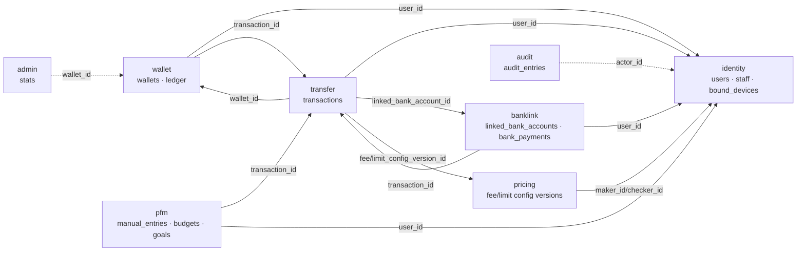
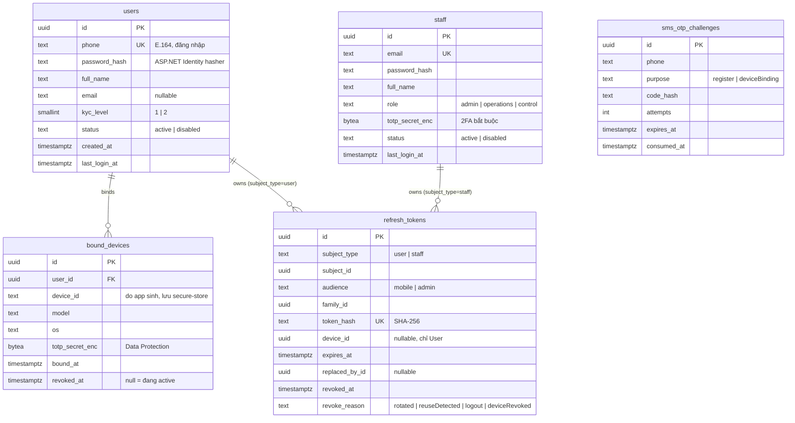
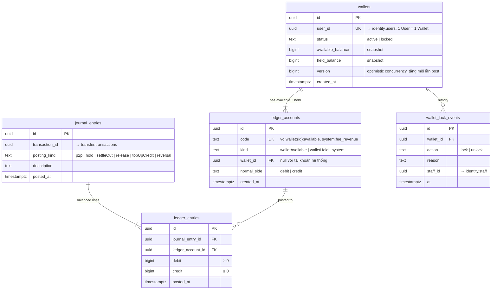
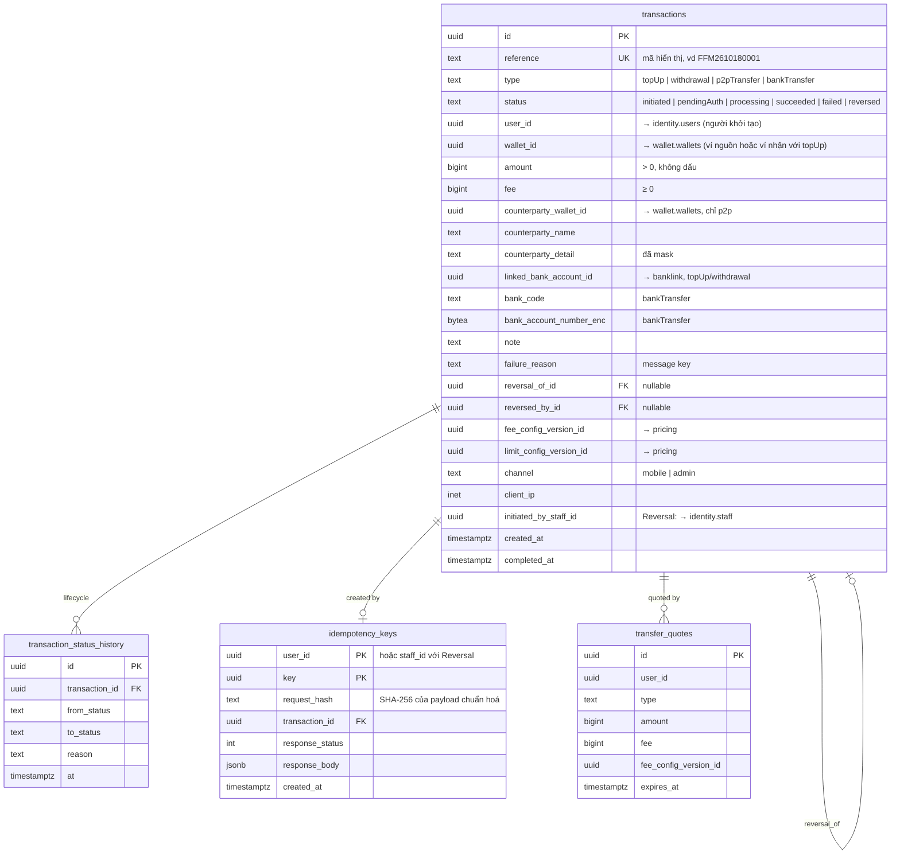
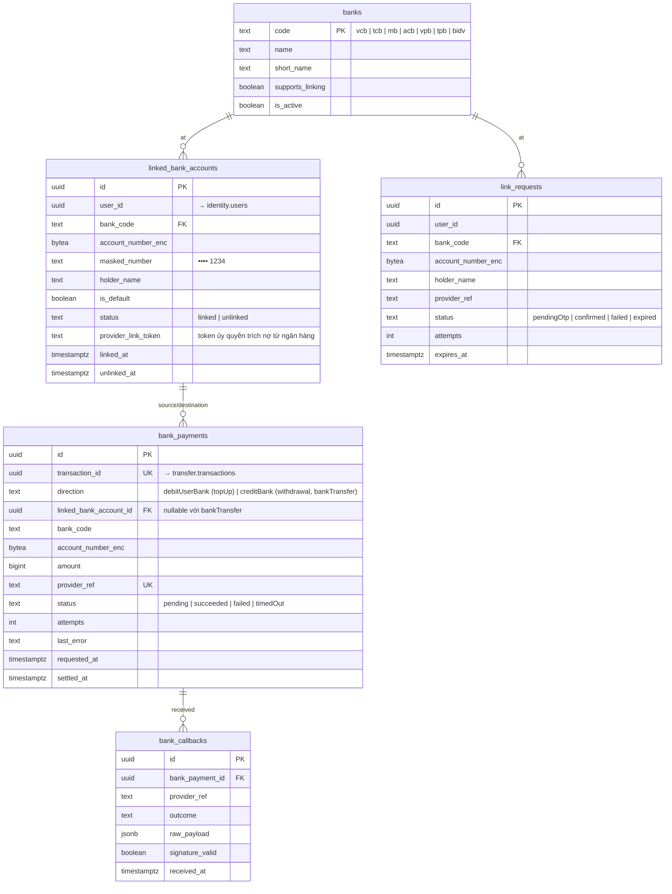
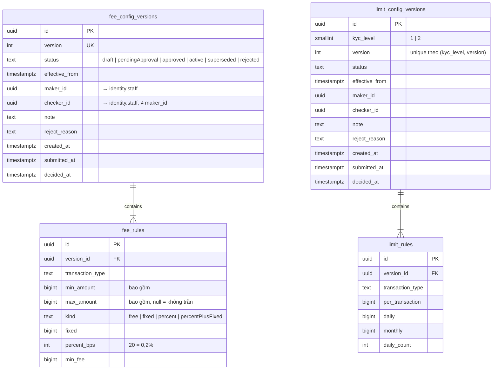
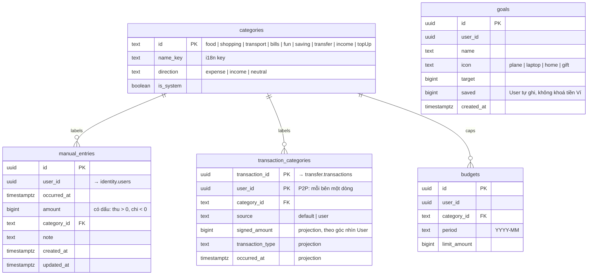
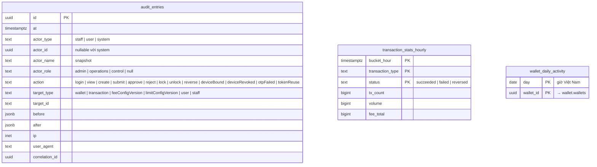
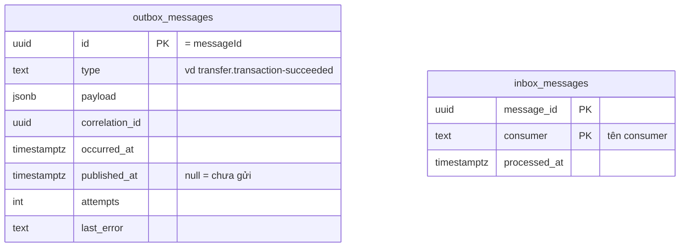

# ERD — Mô hình dữ liệu

PostgreSQL, mỗi feature một schema, tất cả map trong một `FfmDbContext` (ADR-0004). Quy ước chung:

- Khoá chính `uuid` (UUIDv7). Tiền dùng `bigint` (VND nguyên). Thời gian dùng `timestamptz` (UTC). Enum lưu `text` kèm `CHECK`.
- **FK chỉ có trong cùng một schema.** Tham chiếu sang schema khác là *tham chiếu logic*: chỉ lưu id, không có FK. Trong sơ đồ, chúng được ghi chú dạng `→ schema.table`.
- Outbox và inbox là một cặp bảng chung trong schema `messaging` (§9).

## 1. Tổng quan và tham chiếu logic giữa schema

## 2. `identity`

- Unique index một phần `bound_devices (user_id) WHERE revoked_at IS NULL` bảo đảm mỗi User chỉ có **một** Bound Device đang active.
- `users` là bảng của ASP.NET Core Identity: `FfmDbContext` kế thừa `IdentityUserContext<UserIdentity, Guid>`, vẫn là **một** DbContext (ADR-0004). Ngoài các cột ở trên, Identity có thêm cột riêng (`user_name`, `normalized_user_name`, `security_stamp`, `concurrency_stamp`, `lockout_*`, `access_failed_count` …) và ba bảng `user_claims`, `user_logins`, `user_tokens` trong schema `identity`. `user_name` bằng `phone`. Không dùng tên mặc định `AspNet*`.
- Staff không dùng Identity store, vì một Identity context chỉ có một loại TUser. Bảng `staff` tự map và hash mật khẩu bằng `PasswordHasher<Staff>`.

## 3. `wallet` — Ví và Sổ cái

Ràng buộc:

- `ledger_entries`: `CHECK ((debit > 0 AND credit = 0) OR (credit > 0 AND debit = 0))`.
- Mỗi `journal_entry_id` phải có Σdebit = Σcredit. Kiểm ở Domain và bằng một deferred constraint trigger lúc commit.
- `journal_entries`, `ledger_entries`, `wallet_lock_events` là **append-only**: role của ứng dụng không có quyền `UPDATE` / `DELETE` trên chúng.
- Unique `(transaction_id, posting_kind)` để không post trùng một bước khi consumer chạy lại.
- `available_balance ≥ 0` và `held_balance ≥ 0` (`CHECK`).

### 3.1 Tài khoản Sổ cái

| Code | Kind | Normal side | Ý nghĩa |
|---|---|---|---|
| `wallet:{id}:available` | walletAvailable | credit | Số dư khả dụng. Đây là nợ phải trả của hệ thống với User |
| `wallet:{id}:held` | walletHeld | credit | Số dư tạm giữ cho Giao dịch đang xử lý |
| `system:bank_clearing` | system | debit | Tiền đang chờ đối soát với ngân hàng (tài sản) |
| `system:fee_revenue` | system | credit | Doanh thu phí |

Số dư Wallet = available + held = Σcredit − Σdebit trên hai tài khoản của Wallet. Snapshot được cập nhật trong cùng DB transaction với bút toán (ADR-0001).

### 3.2 Bút toán chuẩn

Ký hiệu: A = amount, F = fee. *Nợ* làm giảm tài khoản có normal side là credit.

| Luồng | Bước (`posting_kind`) | Nợ | Có |
|---|---|---|---|
| **P2P Transfer** | `p2p` (một journal) | sender:available A+F | receiver:available A · fee_revenue F |
| **Bank Transfer / Withdrawal** | `hold` (khi gửi lệnh) | wallet:available A+F | wallet:held A+F |
| | `settleOut` (ngân hàng báo thành công) | wallet:held A+F | bank_clearing A · fee_revenue F |
| | `release` (ngân hàng báo thất bại) | wallet:held A+F | wallet:available A+F |
| **Top-up** | `topUpCredit` (ngân hàng báo thành công) | bank_clearing A | wallet:available A − F |
| | | | fee_revenue F (nếu F > 0) |
| **Reversal** | `reversal` (journal mới) | các dòng *Có* của journal gốc | các dòng *Nợ* của journal gốc |

- Top-up thất bại thì không có bút toán, vì tiền chưa vào hệ thống.
- Reversal chỉ áp dụng cho Transaction `Succeeded`. Nếu người phải bị trừ (ví dụ người nhận P2P) không đủ số dư khả dụng thì Reversal bị từ chối với lỗi `insufficientBalanceForReversal`. Sổ cái không cho số dư âm.

## 4. `transfer`

- Index `(wallet_id, created_at DESC)` và `(counterparty_wallet_id, created_at DESC)` phục vụ statement và tính hạn mức đã dùng.
- Hạn mức đã dùng trong ngày/tháng = `SUM(amount)` và `COUNT(*)` các Transaction đi ra của Wallet theo `type`, với `status NOT IN ('failed')`, tính trong khoảng ngày/tháng theo giờ Việt Nam. Truy vấn chạy sau khi đã lock Wallet.
- `transaction_status_history` là append-only. Chuyển trạng thái chỉ được đi theo lifecycle: `Initiated → PendingAuth → Processing → Succeeded | Failed`, `Succeeded → Reversed`.
- `transfer_quotes` chỉ để hiển thị và đối chiếu. Lúc submit, server **tính lại** phí. Nếu phí lệch với quote thì trả `feeChanged` để FE hiển thị lại.

## 5. `banklink`

- Unique index một phần `(user_id) WHERE is_default AND status = 'linked'`.
- Unique index một phần `(user_id, bank_code, masked_number) WHERE status = 'linked'`, để không liên kết trùng một tài khoản.
- Huỷ liên kết là soft (`status = unlinked`), vì Transaction cũ vẫn tham chiếu tới nó.
- `bank_callbacks` lưu mọi callback, kể cả bản trùng hoặc sai chữ ký, để đối soát.

## 6. `pricing`

- `CHECK (checker_id IS NULL OR checker_id <> maker_id)`: maker không thể tự duyệt.
- Một version đã rời trạng thái `draft` thì không sửa được. Trigger chặn `UPDATE` lên rule của version không còn ở `draft`.
- **Resolve** (D12): chọn version có `status IN ('approved','active','superseded')` và `effective_from ≤ t`, lấy `effective_from` lớn nhất (với Hạn mức thì lọc thêm theo `kyc_level`). Không phụ thuộc job đã đổi status hay chưa.
- Phí tính bằng số nguyên: `fee = max(min_fee, fixed + amount * percent_bps / 10000)`, làm tròn **lên** đến đồng. Trong một version, các band `[min_amount, max_amount]` của cùng một loại giao dịch không được chồng nhau.

## 7. `pfm`

- `transaction_categories` được tạo khi consume `TransactionSucceeded` (Category mặc định suy từ `type` và hướng tiền). Khi User đổi Category thì `source = user`, và event đến sau không ghi đè nữa. Khi nhận `TransactionReversed` thì PFM tạo thêm dòng cho Transaction Reversal.
- `budgets` có unique `(user_id, category_id, period)`. Chi tiêu của Budget = Σ |signed_amount| các khoản chi trong kỳ, từ `transaction_categories` cộng `manual_entries`. Mọi thứ tính trong schema `pfm`, không gọi sang Transfer.
- Manual Entry **không bao giờ** chạm Sổ cái hay số dư Wallet.

## 8. `audit` và `admin`

- `audit.audit_entries` là append-only (không cấp quyền `UPDATE`/`DELETE`), có index `(at DESC)`, `(actor_id, at)`, `(target_type, target_id)`.
- Bảng `admin.*` cập nhật bằng upsert `ON CONFLICT … DO UPDATE SET tx_count = tx_count + 1, …` khi consume event Transaction, có inbox để tránh cộng trùng. Lệnh `admin rebuild-stats` tính lại từ `ITransactionQuery`.

## 9. Bảng chung: outbox và inbox (schema `messaging`)

Một cặp bảng cho mọi feature, hiện thực ở `Infrastructure/Messaging`.

Index một phần `outbox_messages (occurred_at) WHERE published_at IS NULL`. Publisher đọc bằng `FOR UPDATE SKIP LOCKED`, nên chạy nhiều instance Worker vẫn an toàn.
