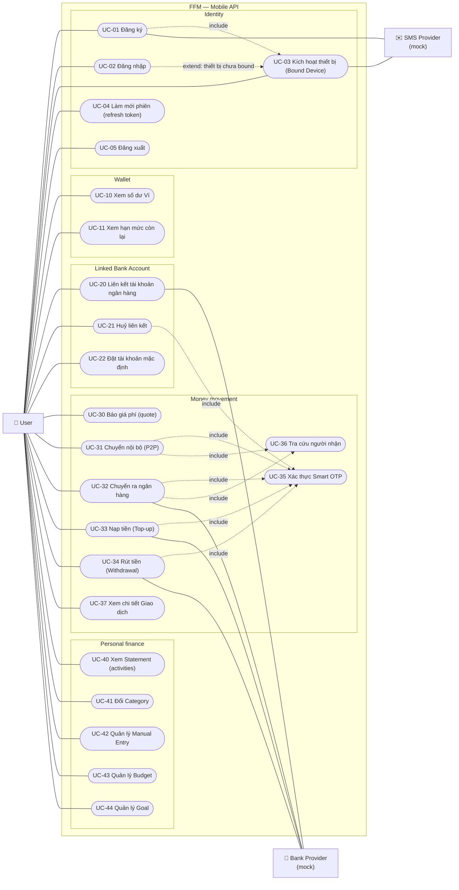
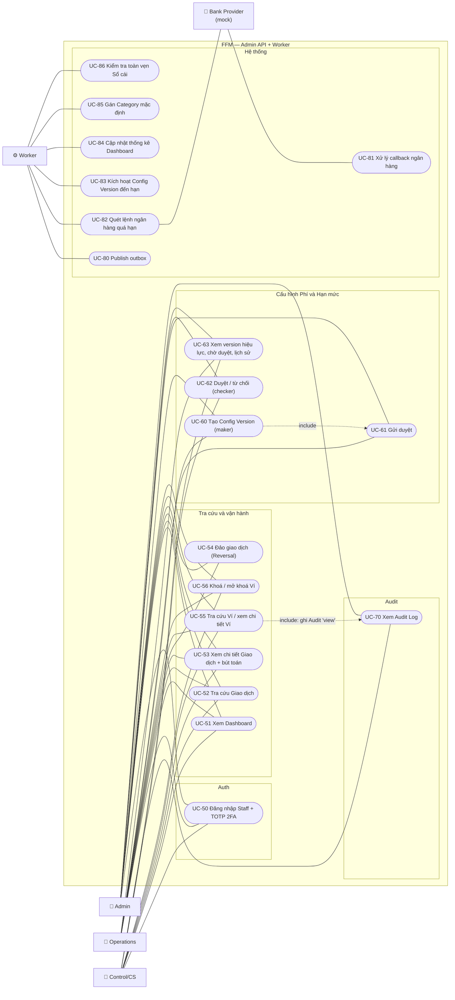

# Use-case

Mermaid không có kiểu sơ đồ use-case riêng, nên ở đây dùng `flowchart`. Actor là node hình chữ nhật có biểu tượng 👤 hoặc ⚙️, use-case là node hình bầu dục, `subgraph` đóng vai ranh giới hệ thống (system boundary). Mã `UC-xx` được dùng lại trong [activities.md](activities.md) và [api.md](api.md).

## 1. Actor

| Actor | Loại | Mô tả |
|---|---|---|
| User | Chính | Người dùng mobile, sở hữu một Wallet |
| Staff — Admin | Chính | Toàn quyền console, kể cả duyệt cấu hình |
| Staff — Operations | Chính | Vận hành: tra cứu, Reversal, Khoá Ví, tạo Config Version (maker) |
| Staff — Control/CS | Chính | Kiểm soát/CSKH: tra cứu, Khoá Ví khi có báo gian lận, duyệt Config Version (checker), xem Audit Log |
| Bank Provider (mock) | Phụ | Xác nhận liên kết bằng OTP ngân hàng, trích nợ hoặc ghi có, gửi callback |
| SMS Provider (mock) | Phụ | Gửi SMS OTP |
| Worker (System) | Phụ | Publish outbox, consume event, chạy job định kỳ |

## 2. User (mobile)

## 3. Staff (admin console) và hệ thống

## 4. Ma trận quyền Staff

Server kiểm quyền ở mọi endpoint. FE chỉ ẩn nút cho đỡ rối, đó là UX chứ không phải bảo mật.

| Use-case | Admin | Operations | Control/CS |
|---|:-:|:-:|:-:|
| UC-51 Dashboard | ✅ | ✅ | ✅ |
| UC-52/53 Tra cứu Giao dịch | ✅ | ✅ | ✅ |
| UC-54 Reversal | ✅ | ✅ | — |
| UC-55 Xem Ví (có ghi Audit) | ✅ | ✅ | ✅ |
| UC-56 Khoá / mở khoá Ví | ✅ | ✅ | ✅ |
| UC-60/61 Tạo và gửi duyệt Config Version | ✅ | ✅ | — |
| UC-62 Duyệt / từ chối Config Version | ✅ (không phải maker) | — | ✅ (không phải maker) |
| UC-63 Xem cấu hình | ✅ | ✅ | ✅ |
| UC-70 Audit Log | ✅ | — | ✅ |

Quy tắc bổ sung:

- Ở UC-62, người duyệt phải khác maker. Kiểm ở handler và bằng `CHECK` trong DB.
- Ở UC-54, một Transaction chỉ được đảo một lần. Không đảo được chính một Reversal. Lý do (`reason`) là bắt buộc.

## 5. Đặc tả tóm tắt

| UC | Tiền điều kiện | Kết quả chính | Ngoại lệ chính |
|---|---|---|---|
| UC-01 Đăng ký | SĐT chưa tồn tại | User + Bound Device + Wallet (async qua `UserRegistered`), trả token (Smart OTP đăng ký sau, ADR-0006) | `phoneAlreadyRegistered`, `invalidSmsOtp`, `smsOtpExpired`, `tooManyAttempts` |
| UC-02 Đăng nhập | User active | Token nếu `device_id` là thiết bị đang bound | `wrongPassword`, `deviceNotBound` (chuyển sang UC-03), `tooManyAttempts` |
| UC-03 Kích hoạt thiết bị | Đúng mật khẩu + SMS OTP | Thiết bị mới active, thiết bị cũ bị thu hồi, `DeviceRevoked` | `invalidSmsOtp` |
| UC-04 Refresh | Token hợp lệ | Cặp token mới, token cũ bị thay | `tokenReuseDetected` (thu hồi cả family) |
| UC-20 Liên kết ngân hàng | Thiết bị bound | Linked Bank Account `linked` | `invalidBankOtp`, `accountAlreadyLinked`, `holderNameMismatch` |
| UC-31 P2P | Wallet active, đủ số dư, trong hạn mức | Transaction `Succeeded` ngay | `overBalance`, `overLimit`, `walletLocked`, `recipientNotFound`, `selfTransfer`, `invalidOtp` |
| UC-32/34 Bank Transfer / Withdrawal | Như trên | Transaction `Processing`, sau đó `Succeeded` hoặc `Failed` theo callback | như trên, cộng `bankUnavailable` |
| UC-33 Top-up | Có Linked Bank Account | Transaction `Processing`, sau đó `Succeeded` hoặc `Failed` | `overLimit`, `invalidOtp` |
| UC-54 Reversal | Transaction `Succeeded`, chưa bị đảo | Transaction Reversal `Succeeded`, gốc chuyển `Reversed` | `notReversible`, `insufficientBalanceForReversal` |
| UC-56 Khoá Ví | — | Wallet `locked`, mọi Transaction làm giảm số dư bị chặn | `alreadyLocked` |
| UC-62 Duyệt | Version `pendingApproval`, checker ≠ maker | `approved`, có hiệu lực từ `effective_from` | `makerCannotApprove`, `effectiveFromInPast` |

Khoá Ví **không** chặn tiền vào (nhận P2P, Top-up đang xử lý) và không chặn việc settle hay release của các Transaction đang `Processing`.
